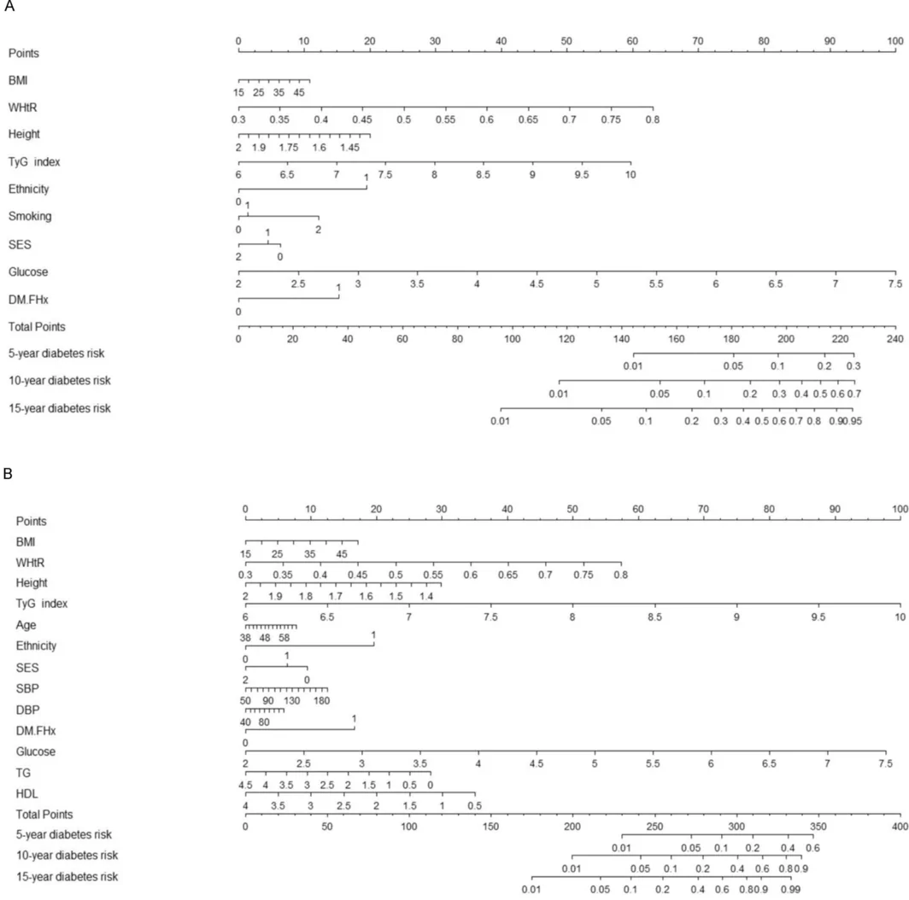
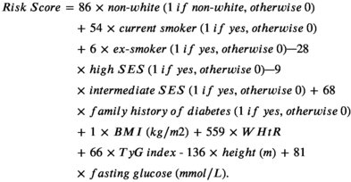
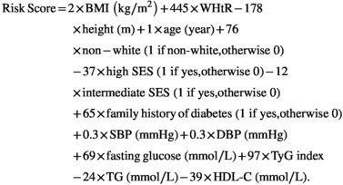
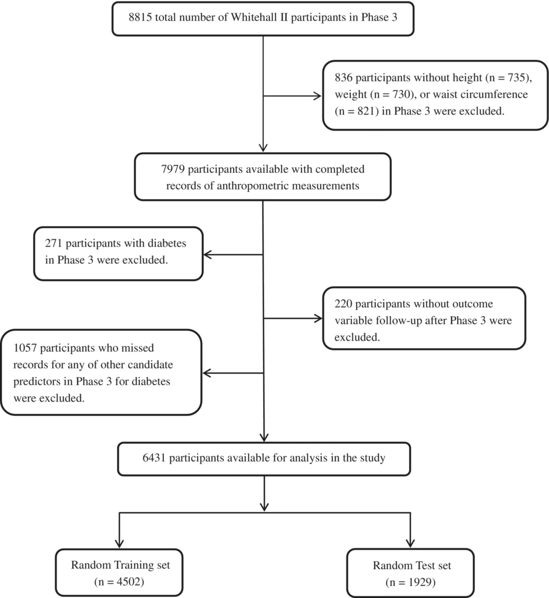

<!-- extracted by pdf-extract | engine=docling | pages=12 | ocr=False | tables=2/2 | density=1.00 | score=100 -->

## Improving Short- and Long-  Term Type 2 Diabetes Risk Prediction for Middle-  Aged British Adults

Cunrong Huang 1 |  Andre Lopes 2 |  Annie Britton 1

1 Department of Epidemiology and Public Health, University College London, London, UK  | 2 Cancer Research UK and Cancer Trials Centre, University College London, London, UK

Correspondence: Cunrong Huang (huang\_cunrong@163.com)  |  Annie Britton (a.britton@ucl.ac.uk)

Received: 16 June 2026  | Revised: 16 August 2026  | Accepted: 20 August 2026

Handling Editor: Richard Donnelly

Keywords: general practice | long-  term risk | prediction tool | short-  term risk | type 2 diabetes

## ABSTRACT

Aims: Diabetes prediction tools are valuable for prevention and resource planning. Few tools exist to predict long-  term diabetes risk for British adults. We aim to develop and validate a diabetes prediction tool for short- and long-  term risk.

Materials  and  Methods: Prediction  model  development  (Training, n =  4502)  and  internal  validation  (Test, n =  1929)  used Whitehall II data (WHII); external validation used English Longitudinal Study of Ageing (ELSA) data, with incident diabetes as outcome. Predictors were selected using LASSO-  Cox, random survival forests (RSF) and best subset selection. Three candidate Cox models were built from these predictor sets and compared. Performance was assessed with C -  indices, calibration and decision curve analysis (DCA). A continuous risk score and quartile-  based risk groups were derived; a nomogram was created. Results: Across WHII Test (235 events) and ELSA (255 events), three models showed broadly similar discrimination, calibration and DCA patterns. LASSO- and RSF-  selected models performed comparably and slightly better than best subset. LASSO and RSF both selected ethnicity, body mass index, waist-  to-  height ratio, height, triglyceride-  glucose index, fasting glucose, family history of diabetes and socioeconomic status; LASSO additionally selected smoking, whereas RSF also included age, triglycerides, high-  density lipoprotein cholesterol, systolic and diastolic blood pressure. In ELSA, risk-  score C -  indices (95% CIs) were 0.800 (0.773-0.827) for the LASSO-  selected model and 0.801 (0.774-0.827) for the RSF-  selected model; risk-  group C -  indices were 0.737 (0.715-0.759) and 0.727 (0.707-0.748), respectively.

Conclusions: We developed and externally validated a tool to estimate 5-  , 10- and 15-  year diabetes risk in British middle-  aged adults, which may support primary care decision-  making.

## 1   |   Introduction

Although  cardiovascular  disease  (CVD)  remains  the  leading cause of death worldwide, significant progress has been made in its prevention and treatment over the past three to four decades [1,  2].  For  CVD  prevention,  the  Framingham  Risk  Score  may have contributed to these advances by estimating an individual's 10-  year cardiovascular risk and enabling early identification of individuals at higher risk [3-5]. Unlike CVD rates, the prevalence of Type 2 diabetes has been rising continuously in recent years [6]. Similar to the Framingham Risk Score for predicting CVD risk, several tools exist for diabetes risk prediction [7-14]. However, these tools have not been widely used in general practice. The use of the Framingham Risk Score in CVD prevention suggests the potential of prediction models for preventing and reducing disease incidence. There remains room for improvement in diabetes risk prediction.

Obesity is a key modifiable risk factor for diabetes [1, 15]. Most existing  prediction  models  use  body  mass  index  (BMI)  as  a

This is an open access article under the terms of the Creative Commons Attribution License, which permits use, distribution and reproduction in any medium, provided the original work is properly cited.

© 2026 The Author(s). Diabetes, Obesity and Metabolism published by John Wiley &amp; Sons Ltd.

predictor, while waist-  based measures, another index for assessing  obesity,  are  less  frequently  considered.  When  waist-  based measures are included, waist circumference (WC) is typically the only one used. Some studies have suggested that waist-  toheight ratio (WHtR), a waist-  based measure, is as strongly associated with diabetes risk as WC but is less influenced by sex and  ethnicity  [16-20].  However,  its  role  in  prediction  models has been less well established. Therefore, the potential value of incorporating WHtR in addition to commonly used measures warrants further evaluation.

Moreover,  most  existing  prediction  models  estimate  risk  at a  single  prediction  horizon,  such  as  a  5-  year  or  10-  year  risk [7, 21]. However, for middle-  aged (40+ years) adults, considering current average life expectancy, a 10-  year or shorter risk prediction may be insufficient, particularly since diabetes risk may progressively increase with age [22, 23]. Therefore, using long-  term prospective data, this study aims to develop a tool to predict individual risk at 5, 10 and 15 years and to support prevention  planning  and  health  management  across  shorter and longer time horizons. In addition to quantitative risk estimates, the present tool provides categorical risk stratification, which may support risk communication, monitoring and use in different practice settings. Some existing tools provide only one form of risk information, which may limit risk assessment in  practice.  Additionally,  the  present  study  applies  complementary statistical approaches to identify key predictors from routinely  available  variables  and  to  develop  a  parsimonious prediction tool.

Overall, this study aims to develop and externally validate a parsimonious diabetes risk prediction tool based on routinely available predictors for use in British general practice.

## 2   |   Materials and Methods

## 2.1   |   Data Collection

This study used data from Whitehall II (WHII) cohort study to build the prediction model for diabetes risk and conduct internal validation, and data from English longitudinal study of ageing (ELSA) for external validation [24-26]. Descriptions of both cohorts are summarised in Table S1. ELSA was selected as an independent, population-  based cohort in England to evaluate the prediction model beyond the occupational WHII cohort. Ethical approval was obtained for both WHII and ELSA, and all participants provided informed consent.

## 2.2   |   Study Sample

In  WHII,  participants  without  baseline  diabetes  and  with complete Phase 3 (1991-1994) data on all candidate predictors (see  Section  2.3)  were  included  in  the  primary  complete-  case analysis and followed until Phase 9 (2007-2009). To internally validate the prediction model, we randomly split the included participants into a Training set (70%) for model training and a Test set (30%) for validation [27]. A flow chart of the included participants is shown in Figure 1. Missing candidate predictor data  before  complete-  case  exclusion  are  reported  in  Table  S2.

In  ELSA  (external  validation),  we  included  persons  without diabetes  at  baseline  who  had  complete  data  for  the  key  variables of the candidate prediction models. The candidate models were developed using different variable screening methods (see Section 2.5.1) in the WHII Training set. External validation in ELSA was performed using data from Wave 2 (2004-2005), with follow-  up until Wave 10 (2021-2023).

## 2.3   |   Candidate Predictors (Initial Variable Pool: 21 Variables in WHII Training Set)

The candidate predictors included age (continuous, years), sex (male  or  female),  ethnicity  (white  or  non-  white),  height  (continuous,  m),  BMI  (continuous,  weight[kg]/height[m] 2 ),  WHtR (continuous, WC[cm]/height[cm]), systolic blood pressure (SBP, continuous, mmHg), diastolic blood pressure (DBP, continuous, mmHg),  triglycerides  (TG,  continuous,  mmol/L),  low-  density lipoprotein  cholesterol  (LDL-  C,  continuous,  mmol/L),  highdensity  lipoprotein  cholesterol  (HDL-  C,  continuous,  mmol/L), triglyceride-  glucose index (TyG index, continuous, TyG index = ln(fasting triglycerides [mg/dL] × fasting plasma glucose [mg/dL]/2)), fasting glucose (continuous, mmol/L), family history of diabetes (yes or no), smoking (never smoker, ex-  smoker, current smoker), drinking (non-  current, current moderate, current  heavy),  fruit/vegetable  consumption  (&lt; daily  or ≥ daily), physical activity (inactive, moderate, or active), socioeconomic status (SES: low, intermediate and high), baseline CVD diagnosis (self-  reported physician-  diagnosed CVD; yes or no) and CVD medication (use of medications for cardiovascular disease; yes or  no).  Detailed  definitions  of  drinking  status,  SES,  physical activity, baseline CVD diagnosis and CVD medication are provided in Table S3. Candidate predictors were selected a priori based on prior literature, clinical relevance to diabetes and data availability [7, 9, 12, 13].

## 2.4   |   Outcome

Incident Type 2 diabetes was defined as having a fasting plasma glucose ≥ 7.0  mmol/L, a 2-  h postload glucose ≥ 11.1  mmol/L at clinical examination, participant report of physician-  diagnosed Type 2 diabetes, use of diabetes medication, or a hospital record of diabetes [28, 29]. Follow-  up began on the survey date of Phase 3 in WHII (Wave 2 in ELSA) and ended at the earliest occurrence of incident diabetes, death, emigration, the last attended follow-  up,  or  the  administrative  end  of  follow-  up  (Phase  9  in WHII; Wave 10 in ELSA).

## 2.5   |   Statistical Analysis

## 2.5.1   |   Analysis in WHII

2.5.1.1 | Selection of Key Predictors. Three methods,  LASSO-  Cox  regression,  random  survival  forests  (RSF) and  best  subset  selection,  were  applied  separately  to  select key  predictors  from  the  initial  variable  pool  (full  model, variables from WHII) for building a simplified model. These methods were chosen to represent complementary approaches to  variable  selection.  LASSO  uses  penalisation  to  mitigate multicollinearity and reduce overfitting; RSF captures nonlinear relationships and interactions; best subset selection evaluates all possible predictor combinations and selects the subset that  optimises  model  performance  (see  below).  Using  complementary methods reduces reliance on any single method and allows predictors to be evaluated from different methodological perspectives.

FIGURE 1 |    Flow chart of the included participants in Whitehall II.

First, we  used  LASSO-  Cox  regression  with  10-  fold crossvalidation  to  identify  predictors  in  the  Training  set.  The  penalty parameter ( λ )  was chosen as the largest value within one standard error of the minimum cross-  validated error [30, 31]. To ensure robustness of predictor selection, we performed LASSOCox  regression  on  1000  bootstrap  samples  in  the  Training set.  Variables  appearing  in ≥ 70%  of  samples  were  retained. Alternative  thresholds  (50%,  60%,  80%)  were  tested  for  sensitivity  analysis.  Second,  we  employed  an  RSF  model  to  identify  key  predictors.  Variable  importance  was  calculated  using permutation-  based measures to assess each variable's contribution to prediction accuracy. A random noise variable was used as a reference. Predictors with importance scores exceeding that of the noise variable were retained [32]. Third, we applied best subset selection to identify optimal predictors by evaluating all possible variable combinations, selecting the model that minimised the Akaike information criterion (AIC) and maximised predictive accuracy [33].

- 2.5.1.2 | Building  the  Prediction  Model. Subsequently, three simplified Cox regression models were developed as candidate models, each using a different set of key predictors from different selection methods.
- 2.5.1.3 | Evaluation  of  Prediction  Performance  After Variable Selection. We evaluated discrimination ( C -  index) and  calibration  of  the  three  candidate  models  in  the  Training and WHII Test sets separately. Time-  dependent C -  indices were  estimated  with  1000  bootstraps.  Bias-  corrected  calibration  curves  based  on  1000  bootstraps  were  compared with  Kaplan-Meier  estimates.  Calibration  slopes  and  5-  , 10- and 15-  year observed-  to-  expected (O/E) ratios were also reported with 95% confidence intervals. These analyses provided internal validation and assessed whether the predictors selected by each method could support model discrimination and calibration.

2.5.1.4 | Comparison  of  Three  Candidate  Models. We then  evaluated  the  performance  of  the  candidate  models  in the WHII Test set and in the external ELSA using discrimination (time-  dependent C -  index)  and  decision  curve  analysis  (DCA). Model  complexity  was  considered  when  performance  differences were minimal. DCA assessed clinical utility across the full probability  range.  As  no  universally  accepted  thresholds  exist for diabetes risk intervention or screening across the prediction horizons examined, we followed a published approach and prespecified  threshold  probabilities  of  25%,  50%  and  75%  to  facilitate model comparison [34]. At each threshold, decision curves of the candidate models were compared with the default strategies of treating all or none. The optimal model at each follow-  up (5, 10, and 15 years) was defined as the one showing higher net benefit than the others and surpassing both default strategies.

2.5.1.5 | Developing the Prediction Tool. Candidate models selected based on an overall consideration of discrimination, calibration and DCA were then developed into prediction tools for use in general practice. As part of prediction-  tool development,  the  linearity  of  continuous  predictors  was  assessed using restricted cubic splines, with details provided in Table S4. Multicollinearity was assessed using variance inflation factors (VIFs) in the WHII Training set. In the Training set, we fitted each selected Cox model to obtain coefficients for selected variables and the baseline survival function. The risk score was calculated as the sum of each regression coefficient multiplied by the observed value of each continuous variable or the coded indicator value of each categorical variable in the model. For presentation, coefficients were rounded to two decimals and multiplied by 100; higher scores indicated higher diabetes risk. Participants in the Training set were divided into quartiles of the risk score to form four relative risk groups (very low, low, medium, high) to ensure a balanced distribution of participants across groups.

2.5.1.6 | Validation of the Prediction Tool. Predicted risks from  the  Training-  set  model  were  validated  against  observed diabetes  incidence  in  the  WHII  Test  set.  Kaplan-Meier  curves illustrated  diabetes-  free  probability  across  the  four  risk  groups in the WHII Training set and the WHII Test set. Discriminatory ability of the risk score and risk-  group classification was assessed using the C -  index in the Training set and the WHII Test set. A nomogram was also constructed from the final simplified Cox model in the Training set: points were assigned to each predictor and summed to a total score to estimate individual predicted risk; higher total scores indicated greater predicted risk.

## 2.5.2 | Analysis in ELSA (External Validation)

In ELSA, C -  indices were calculated for candidate models, risk scores and risk groups and DCA was performed for candidate models.  Training-  set  predicted  risks  were  compared  with  observed  risks  in  ELSA  and  Kaplan-Meier  curves  were  plotted across risk groups.

## 2.5.3 | Sensitivity Analysis

We  examined  whether  prediction  performance  varied  by  the choice of adiposity index (BMI, waist-  based measure, or both) or by the inclusion of invasive variables (requiring a blood test). We conducted sensitivity analyses in the WHII Training set, testing (a) whether including WHtR significantly improved the C -  index and (b)  whether including invasive variables significantly improved the C -  index [35]. As another sensitivity analysis, multiple imputation by chained equations (MICE) was applied to WHII data  before  complete-  case  exclusion,  generating  20  imputed datasets. The imputation model included all candidate predictors,  follow-  up  time  and event status. The same predictor sets as in the primary analysis were used, and Cox regression coefficients for the predictors were pooled across the imputed datasets using Rubin's rules. The resulting continuous risk scores (as described in Section 2.5.1) were externally evaluated in ELSA using C -  indices with 95% confidence intervals.

## 2.5.4 | Additional Analysis Addressing Potential Selection-  Induced Optimism

To enhance transparency regarding potential selection-  induced optimism,  an  additional  analysis  was  conducted  for  the  candidate  model  not  taken  forward  in  the  primary  analysis.  The prediction-  tool development procedures described above for deriving the risk score, risk groups and nomogram were applied.

All  reported p -  values  were  two-  sided.  All  analyses  were  performed in R (version 4.4.1).

## 3   |   Results

## 3.1   |   Developing the Prediction Model

## 3.1.1   |   Characteristics of Included Participants in WHII

A total of 6431 participants without diabetes at Phase 3 were included, with 4502 in the Training set and 1929 in the WHII Test set. The mean age was 49.95 years (SD: 6.01) and 1956 (30.4%) were female (Table 1). There were 782 incident diabetes cases recorded, with a median follow-  up of 16.1 years (Table S5). All candidate  predictors  in  the  initial  variable  pool  were  significantly associated with incident diabetes (Table S6).

## 3.1.2 | Selection of Key Variables

In the Training set, the three methods selected overlapping sets of predictors, including key demographic, anthropometric and metabolic variables. Using LASSO, nine predictors of incident diabetes were selected: ethnicity, WHtR, height, TyG index, fasting glucose, family history of diabetes, smoking, BMI and SES. These variables were selected as they appeared in ≥ 70% of the samples, and the selected set remained unchanged when applying thresholds of 50%, 60% and 80% (Table S7). Using RSF, 13 predictors were selected: age, ethnicity, BMI, height, SBP, DBP, family history of diabetes, SES, WHtR, TG, HDL-  C, fasting glucose and TyG index. Variable importance rankings from the RSF model are shown in Figure S1. By best subset selection, 12 predictors were selected: age, sex, ethnicity, smoking, physical activity, DBP, family history of diabetes, CVD medication, WHtR, fasting glucose, TyG index and HDL-  C. This subset had the lowest AIC. Three candidate Cox models were Note: Drinking status : current moderate (1-14 units/week), current heavy (&gt; 14 units/week); Socioeconomic status : based on last recorded civil service employment grade at baseline; low (clerical or support grades), intermediate (professional or executive grades), and high (administrative grades); Physical activity : inactive (&lt; 1 h/ week of moderate physical activity and &lt; 1 h/week of vigorous physical activity), active (&gt; 2.5 h/week of moderate physical activity or &gt; 1 h/week of vigorous physical activity), or moderate (if not active or inactive); Baseline CVD diagnosis : self-  reported physician-  diagnosed CVD, including coronary heart disease, stroke, and other cardiovascular diseases such as heart failure, arrhythmia, and valvular heart disease; CVD medication: use of medications for cardiovascular disease, such as lipidlowering medication, antianginal medication, and antihypertensive medication; TyG index = ln(fasting triglycerides [mg/dL] × fasting plasma glucose [mg/dL]/2). Abbreviations: BMI, body mass index; CVD, cardiovascular disease; DBP, diastolic blood pressure; HDL-  C, high-  density lipoprotein cholesterol; LDL-  C, low-  density lipoprotein cholesterol; SBP, systolic blood pressure; SD, standard deviation; TG, triglycerides; TyG index, triglyceride-  glucose index; WHII, Whitehall II; WHtR, waist-  toheight ratio.

TABLE 1 |    Baseline (Phase 3) characteristics of all participants in Whitehall II.

|                                    | All, N (%)     | WHII training set, N (%)   | WHII test set, N (%)   |       |
|------------------------------------|----------------|----------------------------|------------------------|-------|
| Characteristic                     | N =6431 (100)  | N =4502 (70)               | N =1929 (30)           | p a   |
| Age, mean±SD, years                | 49.95±6.01     | 49.96±6.00                 | 49.91±6.03             | 0.744 |
| Range                              | (39.60, 63.10) | (39.60, 62.70)             | (39.70, 63.10)         |       |
| Sex (Female), N (%)                | 1956 (30.4)    | 1397 (31.0)                | 559 (29.0)             | 0.108 |
| Ethnicity (White), N (%)           | 5907 (91.9)    | 4143 (92.0)                | 1764 (91.4)            | 0.466 |
| Height, mean±SD,m                  | 1.72±0.09      | 1.72±0.09                  | 1.72±0.09              | 0.950 |
| BMI, mean±SD, kg/m 2               | 25.19±3.66     | 25.17±3.63                 | 25.24±3.73             | 0.425 |
| WHtR, mean±SD                      | 0.48±0.06      | 0.48±0.06                  | 0.49±0.06              | 0.262 |
| SBP, mean±SD,mmHg                  | 120.30±13.57   | 119.99±13.43               | 121.04±13.86           | 0.004 |
| DBP, mean±SD,mmHg                  | 79.58±9.32     | 79.47±9.30                 | 79.84±9.35             | 0.140 |
| TG, mean±SD, mmol/L                | 1.36±0.73      | 1.35±0.74                  | 1.38±0.73              | 0.118 |
| LDL-C, mean±SD, mmol/L             | 4.39±1.04      | 4.37±1.03                  | 4.46±1.05              | 0.001 |
| HDL-C, mean±SD, mmol/L             | 1.45±0.41      | 1.45±0.41                  | 1.43±0.41              | 0.062 |
| Fasting glucose, mean±SD, mmol/L   | 5.19±0.47      | 5.19±0.47                  | 5.19±0.46              | 0.531 |
| TyG index, mean±SD                 | 8.50±0.53      | 8.49±0.53                  | 8.52±0.52              | 0.042 |
| Family history of diabetes, N (%)  | 697 (10.8)     | 480 (10.7)                 | 217 (11.2)             | 0.515 |
| Smoking status, N (%)              |                |                            |                        | 0.219 |
| Never smoker                       | 3069 (47.7)    | 2121 (47.1)                | 948 (49.1)             |       |
| Ex-smoker                          | 2476 (38.5)    | 1764 (39.2)                | 712 (36.9)             |       |
| Current smoker                     | 886 (13.8)     | 617 (13.7)                 | 269 (13.9)             |       |
| Drinking, N (%)                    |                |                            |                        | 0.433 |
| Non-current                        | 1173 (18.2)    | 818 (18.2)                 | 355 (18.4)             |       |
| Current moderate                   | 3676 (57.2)    | 2595 (57.6)                | 1081 (56.0)            |       |
| Current heavy                      | 1582 (24.6)    | 1089 (24.2)                | 493 (25.6)             |       |
| Fruit/vegetable consumption, N (%) |                |                            |                        | 0.142 |
| <Daily                             | 2446 (38.0)    | 1739 (38.6)                | 707 (36.7)             |       |
| ≥ Daily                            | 3985 (62.0)    | 2763 (61.4)                | 1222 (63.3)            |       |
| Physical activity, N (%)           |                |                            |                        | 0.033 |
| Inactive                           | 1244 (19.3)    | 907 (20.1)                 | 337 (17.5)             |       |
| Moderate                           | 2309 (35.9)    | 1613 (35.8)                | 696 (36.1)             |       |
| Active                             | 2878 (44.8)    | 1982 (44.0)                | 896 (46.4)             |       |
| Socioeconomic status, N (%)        |                |                            |                        | 0.987 |
| Low                                | 975 (15.2)     | 681 (15.1)                 | 294 (15.2)             |       |
| Intermediate                       | 2936 (45.6)    | 2058 (45.7)                | 878 (45.5)             |       |
| High                               | 2520 (39.2)    | 1763 (39.2)                | 757 (39.2)             |       |
| Baseline CVDdiagnosis, N (%)       | 593 (9.2)      | 391 (8.7)                  | 202 (10.5)             | 0.026 |
| CVDmedication, N (%)               | 513 (8.0)      | 342 (7.6)                  | 171 (8.9)              | 0.095 |

a p -  Values indicate the comparison between WHII Training set and WHII Test set. Continuous variables were compared using the t -  test, and categorical variables using the chi-  square test.

TABLE 2 |    Time-  dependent C-  index for the candidate models (internal and external validation sets).

|                         | 5years C-index (95% CI)   | 10years C-index (95% CI)   | 15years C-index (95% CI)   |
|-------------------------|---------------------------|----------------------------|----------------------------|
| WHII internal Test set  |                           |                            |                            |
| LASSO                   | 0.753 (0.647, 0.843)      | 0.792 (0.737, 0.843)       | 0.806 (0.772, 0.838)       |
| Random survival forests | 0.764 (0.657, 0.853)      | 0.792 (0.736, 0.844)       | 0.804 (0.770, 0.836)       |
| Best subset selection   | 0.747 (0.635, 0.843)      | 0.788 (0.731, 0.841)       | 0.802 (0.768, 0.836)       |
| ELSA external dataset   |                           |                            |                            |
| LASSO                   | 0.878 (0.844, 0.908)      | 0.820 (0.786, 0.849)       | 0.784 (0.753, 0.814)       |
| Random survival forests | 0.876 (0.843, 0.908)      | 0.822 (0.790, 0.851)       | 0.785 (0.756, 0.813)       |
| Best subset selection   | 0.867 (0.829, 0.902)      | 0.808 (0.773, 0.839)       | 0.770 (0.737, 0.802)       |

Note: Candidate model for LASSO selection (9 variables) includes ethnicity, WHtR, height, TyG index, fasting glucose, family history of diabetes, smoking, BMI, and socioeconomic status. Candidate model for random survival forests selection (13 variables) includes age, ethnicity, BMI, height, SBP, DBP, family history of diabetes, socioeconomic status, WHtR, TG, HDL-  C, fasting glucose, and TyG index. Candidate model for best subset selection (12 variables) includes age, sex, ethnicity, smoking, physical activity, DBP, family history of diabetes, CVD medication, WHtR, fasting glucose, TyG index, and HDL-  C. TyG index = ln(fasting triglycerides [mg/ dL] × fasting plasma glucose [mg/dL]/2).

Abbreviations: BMI, body mass index; CI, confidence interval; CVD, cardiovascular disease; DBP, diastolic blood pressure; HDL-  C, high-  density lipoprotein cholesterol; SBP, systolic blood pressure; TG, triglycerides; TyG index, triglyceride-  glucose index; WHII, Whitehall II; WHtR, waist-  to-  height ratio.

then developed in the Training set, each using predictors selected by LASSO, RSF, or best subset selection.

## 3.1.3 | Validation of the Selected Variables

The  three  simplified  models  showed  broadly  comparable  discrimination to the full model (21 variables) in both the WHII Training  and  Test  sets.  For  example,  in  the  WHII  Test  set  at 10 years,  the C -  index  was  0.792  (95%  CI  0.736-0.844)  for  the RSF-  selected model, 0.792 (95% CI 0.737-0.843) for the LASSOselected model and 0.788 (95% CI 0.731-0.841) for the best subsetselected model, compared with 0.791 (95% CI 0.734-0.843) for the full model (Table S8). Time-  dependent C -  index  curves showed consistent patterns across follow-  up time (Figure S2). All three candidate models demonstrated broadly comparable calibration graphically (Figure S3) and quantitatively (Table S9).

## 3.2   |   Evaluation of Candidate Models in WHII Test Set and ELSA Dataset

## 3.2.1   |   Characteristics of Included Participants in External ELSA Dataset

A total of 2190 participants without diabetes at Wave 2 of ELSA were included in the analysis. The mean age was 63.08 years (SD: 7.10), and 1232 (56.3%) were female. There were 255 incident diabetes  cases  recorded,  with  a  median  follow-  up  of  14.2 years. Compared with the WHII Training set, ELSA participants were older and included higher proportions of women and White participants, with higher baseline BMI and WHtR (Table S10).

## 3.2.2 | Discrimination

The three models showed similar discrimination in both WHII Test  set  and  ELSA  dataset,  with  RSF  and  LASSO  performing  slightly  better  than  best  subset  selection.  For  example,  in ELSA  validation  at  10 years,  the C -  index  was  0.822  (95%  CI

0.790-0.851) for the RSF model, 0.820 (95% CI 0.786-0.849) for the LASSO model and 0.808 (95% CI 0.773-0.839) for the best subset model (Table 2). Time-  dependent C -  index curves showed consistent patterns across follow-  up time (Figure S4).

## 3.2.3 | Decision Curve Analysis

The  three  models  showed  comparable  net  benefit  in  both WHII Test set and ELSA dataset (Figure S5). In WHII Test set, net  benefit  was  similar  at  the  prespecified  thresholds  (25%, 50%, 75%). At 5 and 10 years, net benefit over the 'none' strategy was limited at 50% and 75%, with higher values at 25%. In ELSA, net benefit was broadly similar across models at 5 and 10 years. At 15 years, RSF and LASSO exceeded best subset at the prespecified thresholds. For example, at the 25% threshold net benefits were 0.026, 0.023 and 0.021 for RSF, LASSO and best subset selection, respectively.

## 3.3   |   Transforming Models Into Prediction Tools

The LASSO- and RSF-  selected models showed similar performance, with both performing slightly better than the model using  best  subset  selection.  These  two  models  were  further translated into prediction tools. Linearity assessment identified evidence of non-  linearity for BMI in the LASSO-  selected model and for BMI, TyG and TG in the RSF-  selected model (Table S11). Further evaluation showed comparable predictive performance  between  the  linear  and  restricted  cubic  spline specifications (Tables S12 and S13). Therefore, the linear specifications were retained. All VIFs were below 5 in the LASSOselected model, whereas VIFs exceeded 5 only for TyG index (15.24) and TG (13.12) in the RSF-  selected model (Table S14).

## 3.3.1 | Risk Score and Risk Group

According to the LASSO-  selected model, the risk score was derived as follows:

<!-- Manual extraction correction: PDF page 7, printed page 10580; signs and terms checked against the equation image. -->
Risk Score = 86 × non-white (1 if non-white, otherwise 0)
+ 54 × current smoker (1 if yes, otherwise 0)
+ 6 × ex-smoker (1 if yes, otherwise 0)
− 28 × high SES (1 if yes, otherwise 0)
− 9 × intermediate SES (1 if yes, otherwise 0)
+ 68 × family history of diabetes (1 if yes, otherwise 0)
+ 1 × BMI (kg/m²) + 559 × WHtR
+ 66 × TyG index − 136 × height (m)
+ 81 × fasting glucose (mmol/L).

The  score  ranged  from  724.5  to  1449.2  in  the  Training  set and  was  divided  into  four  risk  categories  by  quartiles:  very low  (&lt; 985),  low  (985-1046),  medium  (1046-1114)  and  high ( ≥ 1114).  Each  cut-  off  value  was  assigned  to  the  group  with the higher score range. Validation yielded C -  indices of 0.786 (95%  CI  0.754-0.817)  in  WHII  Test  set  and  0.800  (95%  CI 0.773-0.827)  in  ELSA  for  the  risk  score,  and  0.759  (95%  CI 0.730-0.788) and 0.737 (95% CI 0.715-0.759) for the risk group categories.  Predicted  risks  in  the  Training  set  and  observed diabetes incidence in the WHII Test set and ELSA at 5, 10 and 15 years are shown in Table S15. In all three datasets, diabetes incidence generally increased from the very-  low- to the highrisk group (Figure S6). Separation was clear between the medium- and high-  risk groups but relatively limited between the very-  low- and low-  risk groups.

According to the RSF-  selected model, the risk score was derived as follows:

<!-- Manual extraction correction: PDF page 7, printed page 10580; signs and terms checked against the equation image. -->
Risk Score = 2 × BMI (kg/m²) + 445 × WHtR
− 178 × height (m) + 1 × age (year)
+ 76 × non-white (1 if non-white, otherwise 0)
− 37 × high SES (1 if yes, otherwise 0)
− 12 × intermediate SES (1 if yes, otherwise 0)
+ 65 × family history of diabetes (1 if yes, otherwise 0)
+ 0.3 × SBP (mmHg) + 0.3 × DBP (mmHg)
+ 69 × fasting glucose (mmol/L) + 97 × TyG index
− 24 × TG (mmol/L) − 39 × HDL-C (mmol/L).

The score ranged from 829.8 to 1563.7 in the Training set and was divided into quartiles: very low (&lt; 1086), low (1086-1152), medium (1152-1220) and high ( ≥ 1220) risk. Validation showed C -  indices  of  0.782  (95%  CI  0.750-0.814)  in  WHII  Test  set  and 0.801 (95% CI 0.774-0.827) in ELSA for the risk score, and 0.750 (95% CI 0.721-0.780) and 0.727 (95% CI 0.707-0.748) for the risk groups.  Predicted  risks  in  the  Training  set  and  observed  diabetes incidence in the WHII Test set and ELSA are shown in Table S16. Diabetes incidence generally increased from the verylow- to the high-  risk group in all three datasets (Figure S7). As with the LASSO-  selected model, separation was clear between the medium- and high-  risk groups but limited between the verylow- and low-  risk groups. Further details on risk stratification and cumulative diabetes incidence at 5, 10 and 15 years are provided in Table S17.

## 3.3.2 | Nomogram

Figure 2 shows nomograms from Cox models using LASSO- and RSF-  selected predictors to estimate 5-  , 10- and 15-  year diabetes risk. For each individual, the value of each predictor is located on its corresponding axis and converted to points using the top scale.  The  points  are  summed  on  the  'Total  Points'  axis  and converted to 5-  , 10- and 15-  year predicted risks using the corresponding bottom scales.

## 3.3.3 | Additional Analysis Addressing Potential Selection-  Induced Optimism

As an additional  analysis,  the  best  subset-  selected  model  was translated into a prediction tool using the same procedures to derive the risk score, risk groups and nomogram. The corresponding tool and performance results are provided in Tables S18-S21 and Figure S8.

## 3.4   |   Sensitivity Analysis

In non-  invasive models with BMI as the adiposity index, adding WHtR led to a clear improvement in the C -  index (Tables S22 and S23). In models that also include blood measures, adding WHtR yielded only small gains in discrimination. The largest increases in C -  index  were  observed after adding blood measures, regardless of whether the baseline model included BMI, WHtR, or both.

Following multiple imputation of the WHII data, external evaluation  in  ELSA  yielded  risk-  score C -  indices  of  0.798  (95%  CI 0.771-0.826) for the LASSO-  selected model and 0.799 (95% CI 0.772-0.826) for the RSF-  selected model. These C -  indices were similar to those in the primary complete-  case analysis.

## 4   |   Discussion

## 4.1   |   Main Findings

This study developed and validated simple tools to predict 5-  , 10and 15-  year diabetes risk in British middle-  aged adults. Using long-  term prospective data, we applied three variable selection methods,  evaluated  models  using  discrimination,  calibration, and DCA, and validated risk scores and groups in internal and external  datasets.  In  ELSA,  the  RSF-  selected  model  achieved a  slightly  higher C -  index  for  risk  scores,  whereas  the  LASSOselected model performed better when scores were grouped. As risk grouping is commonly used in practice to classify individuals into risk categories, the LASSO-  selected model may be more suitable for routine use, while the RSF-  selected model may be useful for more detailed individual risk estimates at 5, 10 and 15 years. Both models included ethnicity, WHtR, height, family history, BMI, SES, TyG index and fasting glucose; LASSO also included  smoking,  while  RSF  additionally  included  age,  TG, HDL-  C, SBP and DBP.

In  the  present  study,  the  three  methods  selected  several  common  predictors,  and  the  resulting  models  showed  generally comparable  performance.  This provides some  reassurance that the findings were not driven by one selection method. The LASSO and RSF models were retained as the two main tools. This decision considered overall performance rather than a single metric. Overall, the LASSO-  selected tool required fewer predictors and may be easier to implement in primary care. Given the small performance differences, claims of relative superiority should be made cautiously.

FIGURE 2 |    Nomogram for predicting 5-  , 10-  , and 15-  year diabetes risk (A) LASSO-  selected model; (B) RSF-  selected model. BMI, body mass index; DBP, diastolic blood pressure; DM.FHx, family history of diabetes; HDL, high-  density lipoprotein cholesterol; RSF, random survival forests; SBP, systolic blood pressure; SES, socioeconomic status; TG, triglycerides; TyG index, triglyceride-  glucose index; WHtR, waist-  to-  height ratio; Glucose refers to fasting plasma glucose. Ethnicity: White = 0, non-  white = 1; SES: Low = 0, intermediate = 1, high = 2; DM.FHx: no = 0, yes = 1; Smoking: never smoker = 0, ex-  smoker = 1, current smoker = 2. Age: years; BMI: kg/m 2 ; Height: m; SBP and DBP: mm Hg; fasting glucose: mmol/L; TG: mmol/L; HDL-  C: mmol/L; TyG index = ln(fasting triglycerides [mg/dL] × fasting plasma glucose [mg/dL]/2).

## 4.2   |   Comparison With Existing Studies

Previous  studies  have  developed  several  diabetes  prediction models [10, 11, 14, 36, 37], mostly cross-  sectional. Even among those based on cohort studies, the reporting of the area under the  ROC  curve  (AUC)  suggests  that  predictions  were  made for a fixed time point [7, 11, 13, 14, 36]. These existing models generally exhibit moderate to good discrimination, with AUCs ranging from approximately 0.70 to 0.85. Since our study used time-  to-  event data, the C -  index is more suitable than AUC for assessing  discrimination.  This  limits  direct  comparison  with previous models reporting AUC.

The predictive metrics in this study, including calibration and a C -  index of 0.78-0.80, suggested that the present prediction model  showed  reasonable  performance  and  was  generally comparable to studies reporting the same metrics [9, 38]. For instance, Rosella et al. developed a tool (Diabetes Population Risk  Tool,  DPoRT)  to  predict  the  9-  year  risk  of  diabetes, demonstrating  good  discriminatory  ability  ( C =  0.77-0.80), which is similar to our results [9]. Some important variables, such as fasting blood glucose, were excluded from their tool as they were not collected in the surveys. However, several studies  showed that incorporating fasting blood glucose into the model may significantly improve prediction accuracy [8, 12], which  supports  our  findings.  In  the  sensitivity  analyses  of our  study,  adding  blood-  based  variables,  including  fasting glucose, increased the C -  index by about 0.05. Compared with the C -  index reported for QDiabetes-  2018 risk prediction algorithm [8], the present tool showed a lower C -  index. However, the reported C -  index values were derived from different study populations rather than from a direct comparison within the same  population  and  should  therefore  be  interpreted  cautiously.  The  QDiabetes-  2018  model  was  developed  in  a  substantially  larger  population  (8.87 million),  which  may  have encompassed  a  broader  distribution  of  individual  risk  profiles, enhancing its ability to distinguish between individuals with  different  levels  of  risk.  It  also  included  additional  predictors, such as schizophrenia and polycystic ovary syndrome in women, which were not available in Phase 3 WHII. These factors may have contributed to its higher discrimination. The present tool is not intended to replace QDiabetes-  2018, but to offer a complementary, parsimonious approach based on routinely available variables. It combines risk stratification with short-  term and long-  term risk estimates to support assessment across different practice settings and time horizons.

Our prediction model showed a slightly higher C -  index in the ELSA dataset than in internal validation. In the present study, the WHII Test set showed a narrower range of risk scores than ELSA, indicating less variation in predicted risk. This difference in the distribution of predicted risk may influence model discrimination, as a wider spread of predicted risk values may allow  greater  separation  between  individuals  with  different outcome  probabilities  and  may  partly  explain  the  slightly higher C -  index  observed  in  ELSA  [39].  The  underlying  reasons  for  this  finding  are  not  fully  clear.  Moreover,  baseline differences between WHII and ELSA indicate that the model was evaluated in an independent population with a different but relevant participant profile. Although external validation supports potential applicability beyond WHII, these findings should be interpreted with caution. DCA indicated potential clinical  utility.  In  WHII,  net  benefit  was  limited  at  the  prespecified  thresholds  of  50%  and  75%,  with  gains  mainly  at 25%  (the  lowest  prespecified  threshold).  This  likely  reflects low 5-  year diabetes incidence and healthier baseline profiles, meaning few participants exceeded higher thresholds. A similar pattern in ELSA suggests greater clinical utility at lower threshold probabilities.

Sensitivity  analyses  provide  insight  into  the  relative  contributions of model components. In non-  invasive models using BMI as the adiposity index, adding WHtR led to some improvement in  discrimination,  suggesting  that  WHtR  may  provide  additional  information  beyond  BMI.  When  blood  measures  were included, adding WHtR resulted in small gains in discrimination.  In  contrast,  the  largest  increases  in  discrimination  were observed with the inclusion of blood measures. These findings suggest that blood-  based variables may contribute to predictive performance. The relative contribution of WHtR appears greater when blood measures are not available.

## 4.3   |   Strengths and Limitations

This  study  provides  5-  ,  10-  and  15-  year  risk  estimates,  allowing  diabetes  risk  to  be  assessed  across  different  time  periods and supporting prevention planning over time. Presenting risk at different stages provides a broader basis for considering the timing and intensity of preventive strategies than a single risk estimate. This study also stratifies individuals into relative risk groups, helping identify those at higher risk who may warrant closer  assessment.  Therefore,  this  study  provides  quantitative and  categorical  risk  information,  which  may  offer  flexibility across different practice settings.

Moreover, this study uses predictors that are routinely available and easily measurable in healthcare settings. This may support its practical use in primary care. Our tool includes measures like WHtR and the TyG index. These were consistently selected in multiple complementary statistical approaches, supporting their inclusion in the final models. WHtR is an alternative to WC and avoids reliance on sex-  specific WC cut-  points. The TyG index is a  surrogate  marker  of  insulin  resistance  derived  from  fasting triglycerides and glucose [40, 41], both commonly measured in practice. These measures may be practical for large-  scale risk assessment. Their inclusion may provide information on metabolic  risk  without  requiring  specialised  additional  testing. Furthermore, the cumulative incidence of diabetes in this study appears broadly consistent with estimates from the general population in England [42]. Findings from the WHII have also been shown to be broadly generalisable to the general UK population [43]. This may support the relevance of the study findings to the general UK population.

This study has some limitations. Ethnicity in WHII was classified  only  as  white  or  non-  white,  which  may  obscure  differences among non-  white groups. WHII consists of British civil servants  and  has  a  limited  socioeconomic  and  ethnic  range. Furthermore,  employment  grade  does  not  capture  all  aspects of socioeconomic status, such as wealth or social capital. These limitations may reduce generalisability to the broader contemporary UK population. HbA 1c was not collected in WHII Phase 3  and  was  therefore  not  included  in  our  model,  despite  being used in some previous models. However, fasting glucose is an established predictor, and the QDiabetes-  2018 model using fasting glucose outperformed the model using HbA 1c instead [8]. Future studies with HbA 1c data  should  assess  whether  adding  HbA 1c further improves prediction. The inclusion of composite indices alongside their constituent variables may introduce overlapping information  and  increase  the  potential  for  multicollinearity.

In  the  RSF-  selected  model,  elevated  VIFs  for  TyG  index  and TG may affect the stability of the risk score across samples, although external validation in ELSA yielded a C-  index of 0.801. Selection-  induced  optimism  from  comparing  three  candidate models and taking two forward partly based on observed performance cannot be excluded. Reporting the supplementary best subset-  based prediction tool improves transparency but does not remove  this  concern.  Further  independent  validation  would help assess reproducibility. Moreover, the generalisability of the tool to younger adults requires further validation. Both cohorts were England-  based, and applicability outside England requires further evaluation. Predictive performance improved with the inclusion of fasting glucose and lipids; fasting glucose was selected by all three methods and ranked highest by RSF. The tool therefore requires blood-  based measures, limiting applicability where blood testing is not feasible. The quartile-  based tool separated the high-  risk group clearly but distinguished the very-  lowand low-  risk groups less clearly. Additionally, in ELSA, diabetes was self-  reported, which may introduce outcome misclassification and influence discrimination estimates in external validation. The number of incident cases was modest, particularly at long follow-  up, which may affect the precision of model evaluation. Sex-  stratified analyses were not performed due to limited sample size  and  number  of  events  after  data  splitting.  Future studies with larger sample sizes may allow investigation of sexspecific models. Selection bias from complete-  case analysis cannot be excluded, although C-  indices were similar after multiple imputation. Finally, this study used baseline measurements to predict long-  term risk and did not account for changes in timevarying factors during follow-  up. Competing risk analysis was not  performed;  treating  death  as  censoring  may  have  overestimated  absolute  long-  term  diabetes  risk,  particularly  among older individuals.

## 5   |   Conclusions

Our  tool  may  support  diabetes  risk  assessment  and  targeted prevention in British middle-  aged adults, with further studies needed to confirm its clinical utility before implementation in practice.

## Funding

The  WHII  study  is  supported  by  the  UK  Medical  Research  Council (R024227, S011676); and the Wellcome Trust (221854/Z/20/Z). However, the authors did not receive direct financial support from these sources.

## Disclosure

The authors have nothing to report.

## Conflicts of Interest

The authors declare no conflicts of interest.

## Data Availability Statement

The WHII data and the ELSA data supporting the results of this study are not publicly available but can be accessed upon application to the respective data custodians. Details on data access for the WHII study are available at https://  www.  ucl.  ac.  uk/  psych  iatry/  resea  rch/  menta  l-  healt h-  older  -  people/  white  hall-  ii/  data-  sharing.  Details  for  the  ELSA  study are available at https://  www.  elsa-  proje  ct.  ac.  uk/  acces  sing-  elsa-  data.

## Peer Review

The  peer  review  history  for  this  article  is  available  at  https://  www. webof  scien  ce.  com/  api/  gatew  ay/  wos/  peer-  review/  10.  1111/  dom.  71289  .

## References

1. N. Sattar, J. M. R. Gill, and W. Alazawi, 'Improving Prevention Strategies for Cardiometabolic Disease,' Nature Medicine 26,  no.  3  (2020): 320-325, https://  doi.  org/  10.  1038/  s4159  1-  020-  0786-  7.
2. X. Sun and T. Du, 'Trends in Cardiovascular Risk Factors Among U.S. Men and Women With and Without Diabetes, 1988-  2014,' BMC Public Health 17, no. 1 (2017): 893, https://  doi.  org/  10.  1186/  s1288  9-  017-  4921-  4.
3. A. Bitton and T. A. Gaziano, 'The Framingham Heart Study's Impact on Global Risk Assessment,' Progress in Cardiovascular Diseases 53, no. 1 (2010): 68-78, https://  doi.  org/  10.  1016/j.  pcad.  2010.  04.  001.
4. R. B. D'Agostino, Sr., R. S. Vasan, M. J. Pencina, et al., 'General Cardiovascular  Risk  Profile  for  Use  in  Primary  Care:  The  Framingham Heart Study,' Circulation 117, no. 6 (2008): 743-753, https://  doi.  org/  10. 1161/  circu  latio  naha.  107.  699579.
5. P.  W.  Wilson, R. B. D'Agostino, D. Levy, A. M. Belanger, H. Silbershatz, and W. B. Kannel, 'Prediction of Coronary Heart Disease Using Risk Factor Categories,' Circulation 97, no. 18 (1998): 1837-1847, https:// doi.  org/  10.  1161/  01.  cir.  97.  18.  1837.
6. G.  Danaei,  M.  M.  Finucane,  Y.  Lu,  et  al.,  'National,  Regional,  and Global  Trends  in  Fasting  Plasma  Glucose  and  Diabetes  Prevalence Since  1980:  Systematic  Analysis  of  Health  Examination  Surveys  and Epidemiological Studies With 370 Country-  Years and 2·7 Million Participants,' Lancet 378,  no.  9785  (2011):  31-40, https://  doi.  org/  10.  1016/ s0140  -  6736(11)  60679  -  x.
7. J. Hippisley-  Cox, C. Coupland, J. Robson, A. Sheikh, and P. Brindle, 'Predicting Risk of Type 2 Diabetes in England and Wales: Prospective Derivation and Validation of QDScore,' BMJ 338 (2009): b880, https:// doi.  org/  10.  1136/  bmj.  b880.
8. J.  Hippisley-  Cox and C. Coupland, 'Development and Validation of QDiabetes-  2018 Risk Prediction Algorithm to Estimate Future Risk of Type 2 Diabetes: Cohort Study,' BMJ 359 (2017): j5019, https://  doi.  org/ 10.  1136/  bmj.  j5019  .
9. L.  C.  Rosella,  D.  G.  Manuel,  C.  Burchill,  and  T.  A.  Stukel,  'A Population-  Based  Risk  Algorithm  for  the  Development  of  Diabetes: Development  and  Validation  of  the  Diabetes  Population  Risk  Tool (DPoRT),' Journal  of  Epidemiology  and  Community  Health 65,  no.  7 (2011): 613-620, https://  doi.  org/  10.  1136/  jech.  2009.  102244.
10. S. J. Griffin, P. S. Little, C. N. Hales, A. L. Kinmonth, and N. J. Wareham, 'Diabetes Risk Score: Towards Earlier Detection of Type 2 Diabetes in General Practice,' Diabetes/Metabolism Research and Reviews 16, no. 3 (2000): 164-171, https://  doi.  org/  10.  1002/  1520-  7560(200005/  06)  16: 3&lt;  164::  aid-  dmrr1  03&gt;  3.0.  co;  2-  r.
11. L. J. Gray, N. A. Taub, K. Khunti, et al., 'The Leicester Risk Assessment Score for Detecting Undiagnosed Type 2 Diabetes and Impaired Glucose Regulation for Use in a Multiethnic UK Setting,' Diabetic Medicine 27, no. 8 (2010): 887-895, https://  doi.  org/  10.  1111/j.  1464-  5491.  2010. 03037.  x.
12. M. I. Schmidt, B. B. Duncan, H. Bang, et al., 'Identifying Individuals at High Risk for Diabetes: The Atherosclerosis Risk in Communities Study,' Diabetes  Care 28,  no.  8  (2005):  2013-2018,  https://  doi.  org/  10. 2337/  diaca  re.  28.8.  2013.
13. J. Lindström and J. Tuomilehto, 'The Diabetes Risk Score: A Practical Tool to Predict Type 2 Diabetes Risk,' Diabetes Care 26, no. 3 (2003): 725-731, https://  doi.  org/  10.  2337/  diaca  re.  26.3.  725.

14. K. E. Heikes, D. M. Eddy, B. Arondekar, and L. Schlessinger, 'Diabetes Risk Calculator: A Simple Tool for Detecting Undiagnosed Diabetes and Pre-  Diabetes,' Diabetes Care 31,  no.  5  (2008):  1040-1045, https:// doi.  org/  10.  2337/  dc07-  1150.
15. M. Blüher, 'Obesity: Global Epidemiology and Pathogenesis,' Nature Reviews. Endocrinology 15,  no.  5  (2019): 288-298, https://  doi.  org/ 10.  1038/  s4157  4-  019-  0176-  8.
16. M. Castanheira, D. Chor, J. U. Braga, et al., 'Predicting Cardiometabolic  Disturbances  From  Waist-  To-  Height  Ratio:  Findings  From  the Brazilian Longitudinal Study of Adult Health (ELSA-  Brasil) Baseline,' Public Health Nutrition 21, no. 6 (2018): 1028-1035, https://  doi.  org/  10. 1017/  S1368  98001  700338X.
17. R.  Meseri, R. Ucku, and B. Unal, 'Waist:Height Ratio: A Superior Index in Estimating Cardiovascular Risks in Turkish Adults,' Public Health Nutrition 17,  no.  10  (2014):  2246-2252, https://  doi.  org/  10.  1017/ S1368  98001  300267X.
18. R.  Kazlauskaite,  E.  F.  Avery-  Mamer,  H.  Li,  et  al.,  'Race/Ethnic Comparisons of Waist-  To-  Height Ratio for Cardiometabolic Screening: The Study of Women's Health Across the Nation,' American Journal of Human  Biology 29,  no.  1  (2017):  e22909,  https://  doi.  org/  10.  1002/  ajhb. 22909  .
19. X. Hou, S. Chen, G. Hu, et al., 'Stronger Associations of Waist Circumference  and  Waist-  To-  Height  Ratio  With  Diabetes  Than  BMI  in Chinese  Adults,' Diabetes  Research  and  Clinical  Practice 147  (2019): 9-18, https://  doi.  org/  10.  1016/j.  diabr  es.  2018.  07.  029.
20. J. Boonpor, S. Parra-  Soto, A. Talebi, et al., 'Associations and Predictive Performance of 11 Anthropometric Measures With Incident Type 2 Diabetes: A Prospective Cohort Study From the UK Biobank,' Obesity (Silver Spring) 31, no. 10 (2023): 2648-2657, https://  doi.  org/  10.  1002/  oby. 23849  .
21. P. W. Wilson, J. B. Meigs, L. Sullivan, C. S. Fox, D. M. Nathan, and R. B. D'Agostino, Sr., 'Prediction of Incident Diabetes Mellitus in MiddleAged Adults: The Framingham Offspring Study,' Archives of Internal Medicine 167,  no.  10  (2007):  1068-1074,  https://  doi.  org/  10.  1001/  archi nte.  167.  10.  1068.
22. K. Junker, C. M. Buckley, S. R. Millar, et al., 'The Prevalence and Correlates of Pre-  Diabetes in Middle- To Older-  Aged Irish Adults Using Three Diagnostic Methods,' PLoS One 16, no. 6 (2021): e0253537, https:// doi.  org/  10.  1371/  journ  al.  pone.  0253537.
23. M. Xia, K. Liu, J. Feng, Z. Zheng, and X. Xie, 'Prevalence and Risk Factors of Type 2 Diabetes and Prediabetes Among 53,288 Middle-  Aged and Elderly Adults in China: A Cross-  Sectional Study,' Diabetes, Metabolic  Syndrome and Obesity 14  (2021):  1975-1985,  https://  doi.  org/  10. 2147/  DMSO.  S305919.
24. M.  Marmot  and  E.  Brunner,  'Cohort  Profile:  The  Whitehall  II Study,' International Journal of Epidemiology 34, no. 2 (2005): 251-256, https://  doi.  org/  10.  1093/  ije/  dyh372.
25. M. G. Marmot, G. D. Smith, S. Stansfeld, et al., 'Health Inequalities Among British Civil Servants: The Whitehall II Study,' Lancet 337, no. 8754 (1991): 1387-1393, https://  doi.  org/  10.  1016/  0140-  6736(91)  93068  -  k.
26. A. Steptoe, E. Breeze, J. Banks, and J. Nazroo, 'Cohort Profile: The English Longitudinal Study of Ageing,' International Journal of Epidemiology 42, no. 6 (2013): 1640-1648, https://  doi.  org/  10.  1093/  ije/  dys168.
27. B.  Vrigazova,  'The  Proportion  for  Splitting  Data  Into  Training and  Test  Set  for  the  Bootstrap  in  Classification  Problems,' Business Systems  Research 12,  no.  1  (2021):  228-242,  https://  doi.  org/  10.  2478/ bsrj-  2021-  0015.
28. C. Barbiellini Amidei, A. Fayosse, J. Dumurgier, et al., 'Association Between  Age  at  Diabetes  Onset  and  Subsequent  Risk  of  Dementia,' Journal of the American Medical Association 325, no. 16 (2021): 16401649, https://  doi.  org/  10.  1001/  jama.  2021.  4001.
29. A. G. Tabák, M. Jokela, T. N. Akbaraly, E. J. Brunner, M. Kivimäki, and D. R. Witte, 'Trajectories of Glycaemia, Insulin Sensitivity, and Insulin Secretion Before Diagnosis of Type 2 Diabetes: An Analysis From the Whitehall II Study,' Lancet 373, no. 9682 (2009): 2215-2221, https:// doi.  org/  10.  1016/  S0140  -  6736(09)  60619  -  X.
30. M. Sill, T. Hielscher, N. Becker, and M. Zucknick, 'c060: Extended Inference With Lasso and Elastic-  Net Regularized Cox and Generalized Linear Models,' Journal of Statistical Software 62,  no.  5  (2015):  1-22, https://  doi.  org/  10.  18637/  jss.  v062.  i05.
31. J. K. Tay, B. Narasimhan, and T. Hastie, 'Elastic Net Regularization Paths  for  All  Generalized  Linear  Models,' Journal  of  Statistical  Software 106, no. 1 (2023): 1-31, https://  doi.  org/  10.  18637/  jss.  v106.  i01.
32. R.  Genuer,  J.-  M.  Poggi,  and  C.  Tuleau-  Malot,  'Variable  Selection Using Random Forests,' Pattern Recognition Letters 31,  no.  14  (2010): 2225-2236, https://  doi.  org/  10.  1016/j.  patrec.  2010.  03.  014.
33. D.  Bertsimas,  A.  King,  and  R.  Mazumder,  'Best  Subset  Selection via a Modern Optimization Lens,' Annals of Statistics 44, no. 2 (2016): 813-852, https://  doi.  org/  10.  1214/  15-  AOS1388.
34. Q.  Yang,  T.  Liu,  R.  Valdez,  R.  Moonesinghe,  and  M.  J.  Khoury, 'Improvements  in  Ability  to  Detect  Undiagnosed  Diabetes  by  Using Information on Family History Among Adults in the United States,' American Journal of Epidemiology 171, no. 10 (2010): 1079-1089, https:// doi.  org/  10.  1093/  aje/  kwq026.
35. L. Kang, W. Chen, N. A. Petrick, and B. D. Gallas, 'Comparing Two Correlated C Indices With Right-  Censored Survival Outcome: A OneShot Nonparametric Approach,' Statistics in Medicine 34, no. 4 (2015): 685-703, https://  doi.  org/  10.  1002/  sim.  6370.
36. X. Zhou, Q. Qiao, L. Ji, et al., 'Nonlaboratory-  Based Risk Assessment  Algorithm  for  Undiagnosed  Type  2  Diabetes  Developed  on  a Nation-  Wide Diabetes Survey,' Diabetes Care 36,  no. 12 (2013): 39443952, https://  doi.  org/  10.  2337/  dc13-  0593.
37. C.  A.  Robinson,  G.  Agarwal,  and  K.  Nerenberg,  'Validating  the CANRISK Prognostic Model for Assessing Diabetes Risk in Canada's Multi-  Ethnic Population,' Chronic Diseases and Injuries in Canada 32, no. 1 (2011): 19-31.
38. A. P. Kengne, J. W. Beulens, L. M. Peelen, et al., 'Non-  Invasive Risk Scores for Prediction of Type 2 Diabetes (EPIC-  InterAct): A Validation of  Existing Models,' Lancet Diabetes &amp; Endocrinology 2,  no.  1  (2014): 19-29, https://  doi.  org/  10.  1016/  s2213  -  8587(13)  70103  -  7.
39. E. W. Steyerberg, A. J. Vickers, N. R. Cook, et al., 'Assessing the Performance of Prediction Models: A Framework for Traditional and Novel Measures,' Epidemiology 21,  no.  1  (2010):  128-138, https://  doi.  org/  10. 1097/  EDE.  0b013  e3181  c30fb2.
40. F.  Guerrero-  Romero,  L.  E.  Simental-  Mendía,  M.  González-  Ortiz, et al., 'The Product of Triglycerides and Glucose, a Simple Measure of Insulin Sensitivity. Comparison With the Euglycemic-  Hyperinsulinemic Clamp,' Journal  of  Clinical  Endocrinology  and  Metabolism 95,  no.  7 (2010): 3347-3351, https://  doi.  org/  10.  1210/  jc.  2010-  0288.
41. L.  E.  Simental-  Mendía,  M.  Rodríguez-  Morán,  and  F.  GuerreroRomero, 'The Product of Fasting Glucose and Triglycerides as Surrogate for Identifying Insulin Resistance in Apparently Healthy Subjects,' Metabolic  Syndrome  and  Related  Disorders 6,  no.  4  (2008):  299-304, https://  doi.  org/  10.  1089/  met.  2008.  0034.
42. N. G. Forouhi, J. Luan, S. Hennings, and N. J. Wareham, 'Incidence of Type 2 Diabetes in England and Its Association With Baseline Impaired Fasting Glucose: The Ely Study 1990-  2000,' Diabetic Medicine 24,  no.  2  (2007):  200-207,  https://  doi.  org/  10.  1111/j.  1464-  5491.  2007. 02068.  x.
43. G. D. Batty, M. Shipley, A. Tabák, et al., 'Generalizability of Occupational Cohort Study Findings,' Epidemiology 25, no. 6 (2014): 932-933, https://  doi.  org/  10.  1097/  ede.  00000  00000  000184.

## Supporting Information

Additional supporting information can be found online in the Supporting Information section. Table S1: Cohort descriptions: Whitehall II (WHII) Study and English Longitudinal Study of Ageing (ELSA). Table  S2: Missing  data  for  initial  candidate  predictors  in Whitehall II (WHII). Table S3: Definitions of variables requiring additional  clarification. Table  S4: Supplementary  methods  for  assessing  linearity. Table  S5: Incident  diabetes  and  follow-  up  information in  Whitehall II. Table S6: Univariate analyses for testing the association  between  potential  predictors  and  incident  diabetes  (Whitehall II). Table S7: LASSO-  Cox modelling results of potential predictors for incident diabetes (Whitehall II). Table S8: Results of time-  dependent C -  index (95% CI) for three candidate prediction models (Whitehall II). Table  S9: Quantitative  calibration  metrics  for  the  candidate  models in the WHII Training and Test sets. Table S10: Characteristics of included participants in ELSA and comparisons with the WHII Training set. Table S11: Assessment of non-  linearity for continuous predictors in LASSO-  selected and RSF-  selected models in the WHII Training set. Table S12: Sensitivity analysis comparing linear and restricted cubic spline  modelling  of  BMI  in  the  LASSO-  selected  model  in  the  WHII Test set. Table S13: Sensitivity analysis comparing linear and restricted cubic  spline  specifications  for  BMI,  TyG  index  and  TG  in  the  RSFselected model in the WHII Test set. Table S14: Variance inflation factors for the LASSO- and RSF-  based Cox models in the WHII Training set. Table S15: Predicted and observed diabetes incidence at 5, 10 and 15 years by risk groups according to risk score cut-  off values (LASSOselected model). Table S16: Predicted and observed diabetes incidence at 5, 10 and 15 years by risk groups according to risk score cut-  off values (RSF-  selected model). Table S17: Risk score-  based stratification and cumulative diabetes incidence in the WHII Training set, WHII Test set and ELSA dataset. Table S18: Variance inflation factors for the best subsetselected Cox model in the WHII Training set. Table S19: Assessment of  non-  linearity  for  continuous  predictors  in  the  best  subset-  selected model  in  the  WHII  Training  set. Table  S20: Comparison  of  linear and restricted cubic spline specifications for fasting glucose in the best subset-  selected model in the WHII Test set. Table S21: Risk score, riskgroup definitions and discrimination of the prediction tool based on the best subset-  selected model. Table S22: Discrimination performance of LASSO-  selected prediction models: C -  index and pairwise comparisons (Whitehall  II  Training  set). Table  S23: Discrimination  performance of RSF-  selected prediction models: C -  index and pairwise comparisons (Whitehall  II  Training  set). Figure  S1: Out-  of-  bag  (OOB)  prediction error  plot  and  random  forest  variable  importance  plot  (Whitehall  II Training set). Figure S2: Time-  dependent  concordance  index  curves for  three  candidate  prediction  models  in  Whitehall  II. Figure  S3: Calibration plots for 5-  , 10- and 15-  year diabetes-  free survival following the simplified model after bootstrapping (Whitehall II). Figure S4: Time-  dependent concordance index curves for simplified models (internal and external validation sets). Figure S5: Decision curve analysis for validation and comparison of the candidate simplified models in WHII Test and ELSA datasets. Figure S6: Kaplan-Meier curves for incident diabetes  by  risk  group  in  the  WHII  Training  set,  WHII  Test  set  and ELSA (LASSO-  selected model). Figure S7: Kaplan-Meier  curves  for incident diabetes by risk group in the WHII Training set, WHII Test set and ELSA (RSF-  selected model). Figure S8: Nomogram for predicting 5-  , 10- and 15-  year diabetes risk (additional analysis for the best subsetselected model).
