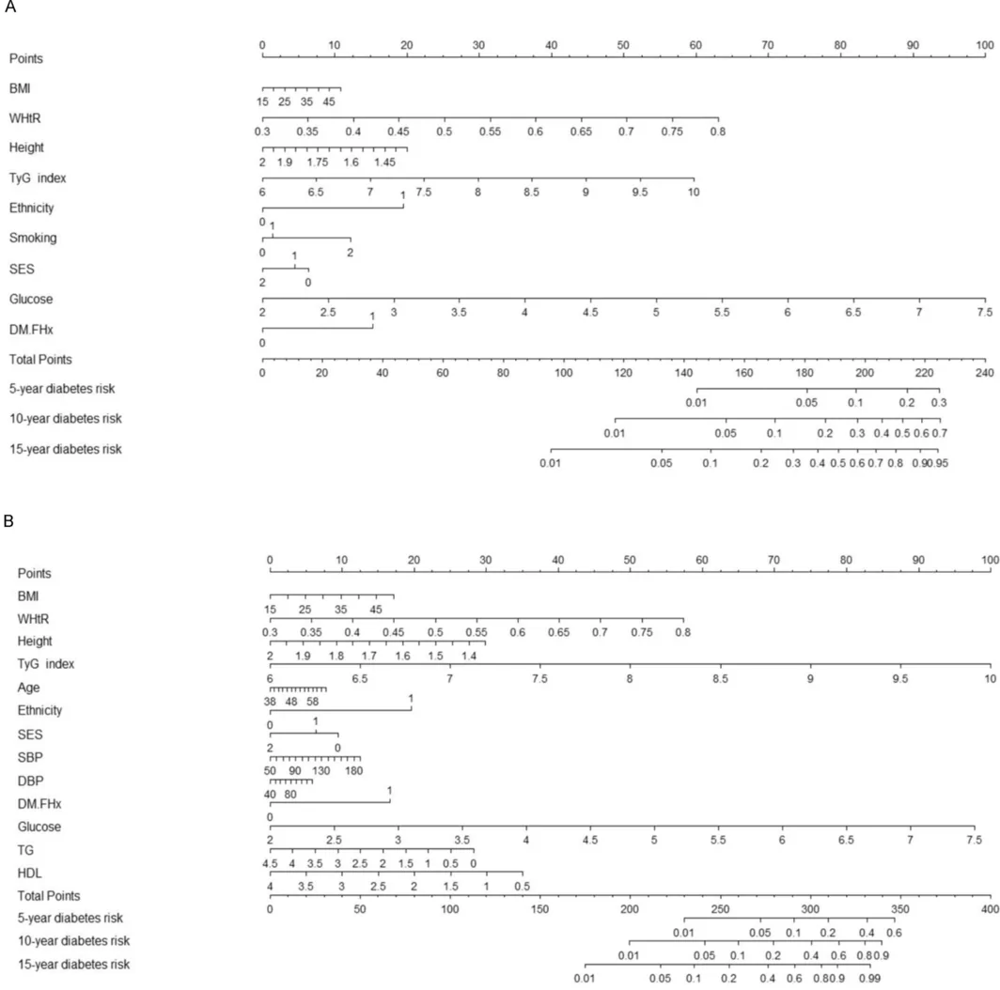
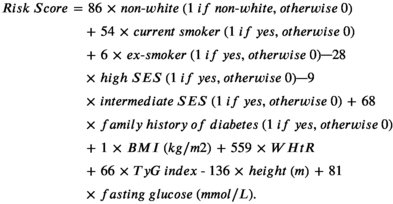
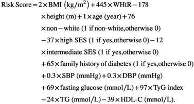
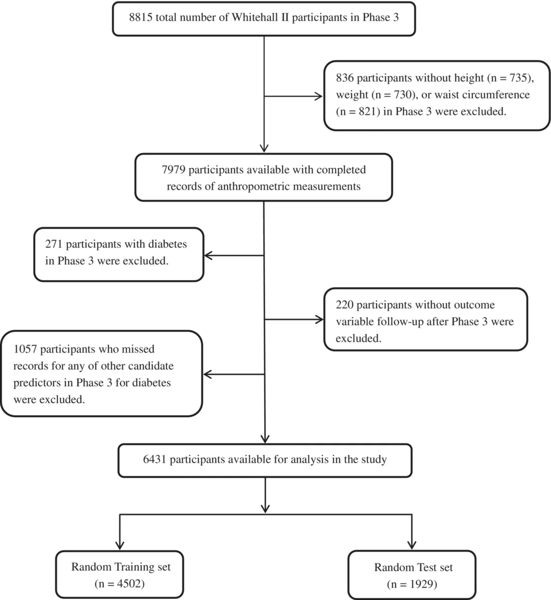

<!-- extracted by pdf-extract | engine=docling | pages=12 | ocr=False | tables=2/2 | density=1.00 | score=100 -->

## Cải thiện dự đoán nguy cơ đái tháo đường típ 2 ngắn hạn và dài hạn ở người trưởng thành trung niên tại Anh

Cunrong Huang 1 |  Andre Lopes 2 |  Annie Britton 1

1 Department of Epidemiology and Public Health, University College London, London, UK  | 2 Cancer Research UK and Cancer Trials Centre, University College London, London, UK

Liên hệ: Cunrong Huang (huang\_cunrong@163.com)  |  Annie Britton (a.britton@ucl.ac.uk)

Nhận bài: 16 tháng Sáu 2026  | Sửa đổi: 16 tháng Tám 2026  | Chấp nhận: 20 tháng Tám 2026

Biên tập viên phụ trách: Richard Donnelly

Từ khóa: thực hành đa khoa | nguy cơ dài hạn | công cụ dự đoán | nguy cơ ngắn hạn | đái tháo đường típ 2

## TÓM TẮT

Mục tiêu: Các công cụ dự đoán đái tháo đường có giá trị đối với phòng bệnh và lập kế hoạch nguồn lực. Hiện có ít công cụ dự đoán nguy cơ đái tháo đường dài hạn cho người trưởng thành tại Anh. Chúng tôi hướng đến phát triển và kiểm định một công cụ dự đoán nguy cơ đái tháo đường ngắn hạn và dài hạn.

Đối tượng và phương pháp: Dữ liệu Whitehall II (WHII) được sử dụng để phát triển mô hình dự đoán (tập huấn luyện, n = 4502) và kiểm định nội bộ (tập kiểm định, n = 1929); kiểm định bên ngoài sử dụng dữ liệu English Longitudinal Study of Ageing (ELSA), với kết cục là đái tháo đường mắc mới. Các biến dự báo được lựa chọn bằng LASSO-Cox, rừng sống còn ngẫu nhiên (random survival forests, RSF) và lựa chọn tập con tốt nhất. Ba mô hình Cox ứng viên được xây dựng từ các tập biến dự báo này và được so sánh. Hiệu năng được đánh giá bằng C-index, độ hiệu chuẩn và phân tích đường cong quyết định (decision curve analysis, DCA). Một điểm nguy cơ liên tục và các nhóm nguy cơ dựa trên tứ phân vị được xây dựng; một toán đồ (nomogram) cũng được tạo ra. Kết quả: Trong tập kiểm định WHII (235 biến cố) và ELSA (255 biến cố), ba mô hình nhìn chung có các đặc điểm tương tự về khả năng phân biệt, độ hiệu chuẩn và DCA. Các mô hình sử dụng biến do LASSO và RSF lựa chọn có hiệu năng tương đương nhau và tốt hơn một chút so với lựa chọn tập con tốt nhất. Cả LASSO và RSF đều lựa chọn nhóm sắc tộc, chỉ số khối cơ thể, tỷ số vòng eo/chiều cao, chiều cao, chỉ số triglyceride-glucose, glucose lúc đói, tiền sử gia đình mắc đái tháo đường và vị thế kinh tế xã hội; LASSO lựa chọn thêm tình trạng hút thuốc, trong khi RSF còn lựa chọn tuổi, triglyceride, cholesterol lipoprotein tỷ trọng cao, huyết áp tâm thu và huyết áp tâm trương. Trong ELSA, C-index của điểm nguy cơ (khoảng tin cậy 95%) là 0.800 (0.773-0.827) đối với mô hình có biến do LASSO lựa chọn và 0.801 (0.774-0.827) đối với mô hình có biến do RSF lựa chọn; C-index của nhóm nguy cơ lần lượt là 0.737 (0.715-0.759) và 0.727 (0.707-0.748).

Kết luận: Chúng tôi đã phát triển và kiểm định bên ngoài một công cụ ước tính nguy cơ đái tháo đường trong 5, 10 và 15 năm ở người trưởng thành trung niên tại Anh; công cụ này có thể hỗ trợ việc ra quyết định trong chăm sóc ban đầu.

## 1   |   Đặt vấn đề

Mặc dù bệnh tim mạch (cardiovascular disease, CVD) vẫn là nguyên nhân tử vong hàng đầu trên toàn thế giới, công tác phòng ngừa và điều trị đã đạt được những tiến bộ đáng kể trong ba đến bốn thập kỷ qua [1,  2]. Đối với phòng ngừa CVD, thang điểm nguy cơ Framingham có thể đã góp phần vào những tiến bộ này thông qua việc ước tính nguy cơ tim mạch trong 10 năm của từng người, qua đó giúp phát hiện sớm những người có nguy cơ cao hơn [3-5]. Khác với tỷ lệ CVD, tỷ lệ hiện mắc đái tháo đường típ 2 liên tục gia tăng trong những năm gần đây [6]. Tương tự thang điểm nguy cơ Framingham dùng để dự đoán nguy cơ CVD, hiện có một số công cụ dự đoán nguy cơ đái tháo đường [7-14]. Tuy nhiên, các công cụ này chưa được sử dụng rộng rãi trong thực hành đa khoa. Việc sử dụng thang điểm nguy cơ Framingham để phòng ngừa CVD cho thấy tiềm năng của các mô hình dự đoán trong phòng ngừa và giảm số ca bệnh mắc mới. Dự đoán nguy cơ đái tháo đường vẫn còn có thể được cải thiện.

Béo phì là một yếu tố nguy cơ quan trọng có thể thay đổi được của đái tháo đường [1, 15]. Phần lớn các mô hình dự đoán hiện có sử dụng chỉ số khối cơ thể (body mass index, BMI) làm

Đây là bài báo truy cập mở theo các điều khoản của giấy phép Creative Commons Attribution, cho phép sử dụng, phân phối và tái tạo trên bất kỳ phương tiện nào, với điều kiện tác phẩm gốc được trích dẫn đúng quy định.

© 2026 Các tác giả. Diabetes, Obesity and Metabolism do John Wiley &amp; Sons Ltd. xuất bản.

biến dự báo, trong khi các chỉ số dựa trên vòng eo, một nhóm chỉ số khác dùng để đánh giá béo phì, ít được cân nhắc hơn. Khi đưa các chỉ số dựa trên vòng eo vào mô hình, chu vi vòng eo (waist circumference, WC) thường là chỉ số duy nhất được sử dụng. Một số nghiên cứu gợi ý rằng tỷ số vòng eo/chiều cao (waist-to-height ratio, WHtR), một chỉ số dựa trên vòng eo, có mức độ liên quan với nguy cơ đái tháo đường mạnh tương đương WC nhưng ít chịu ảnh hưởng của giới và nhóm sắc tộc hơn [16-20]. Tuy nhiên, vai trò của WHtR trong các mô hình dự đoán chưa được xác lập rõ. Vì vậy, giá trị tiềm năng của việc bổ sung WHtR bên cạnh các chỉ số thường dùng cần được đánh giá thêm.

Ngoài ra, phần lớn các mô hình dự đoán hiện có ước tính nguy cơ tại một thời hạn dự báo duy nhất, chẳng hạn nguy cơ trong 5 năm hoặc 10 năm [7, 21]. Tuy nhiên, đối với người trung niên (40+ tuổi), xét đến tuổi thọ trung bình hiện nay, dự đoán nguy cơ trong 10 năm hoặc ngắn hơn có thể chưa đủ, đặc biệt vì nguy cơ đái tháo đường có thể tăng dần theo tuổi [22, 23]. Do đó, nghiên cứu này sử dụng dữ liệu tiến cứu dài hạn nhằm phát triển một công cụ dự đoán nguy cơ của từng cá nhân tại các mốc 5, 10 và 15 năm, đồng thời hỗ trợ lập kế hoạch phòng bệnh và quản lý sức khỏe trong cả thời gian ngắn hạn lẫn dài hạn. Bên cạnh các ước tính nguy cơ định lượng, công cụ còn cung cấp phân tầng nguy cơ theo nhóm, có thể hỗ trợ trao đổi thông tin về nguy cơ, theo dõi và sử dụng trong các bối cảnh thực hành khác nhau. Một số công cụ hiện có chỉ cung cấp một dạng thông tin nguy cơ, điều này có thể hạn chế việc đánh giá nguy cơ trong thực hành. Nghiên cứu này cũng áp dụng các cách tiếp cận thống kê bổ trợ cho nhau để xác định các biến dự báo chủ chốt từ những biến thường sẵn có và phát triển một công cụ dự đoán gọn với số biến hợp lý.

Nhìn chung, nghiên cứu hướng đến phát triển và kiểm định bên ngoài một công cụ dự đoán nguy cơ đái tháo đường gọn, dựa trên các biến dự báo thường sẵn có, để sử dụng trong thực hành đa khoa tại Anh.

## 2   |   Đối tượng và phương pháp

## 2.1   |   Thu thập dữ liệu

Nghiên cứu sử dụng dữ liệu từ nghiên cứu đoàn hệ Whitehall II (WHII) để xây dựng mô hình dự đoán nguy cơ đái tháo đường và thực hiện kiểm định nội bộ, đồng thời sử dụng dữ liệu English Longitudinal Study of Ageing (ELSA) để kiểm định bên ngoài [24-26]. Mô tả của cả hai đoàn hệ được tóm tắt trong Bảng S1. ELSA được lựa chọn làm đoàn hệ độc lập, dựa trên dân số tại Anh, nhằm đánh giá mô hình dự đoán ngoài đoàn hệ nghề nghiệp WHII. Cả WHII và ELSA đều được phê duyệt về đạo đức nghiên cứu, và tất cả người tham gia đều đồng ý tham gia sau khi được cung cấp thông tin.

## 2.2   |   Mẫu nghiên cứu

Trong WHII, những người chưa mắc đái tháo đường tại thời điểm ban đầu và có đủ dữ liệu Giai đoạn 3 (1991-1994) đối với tất cả các biến dự báo ứng viên (xem Mục 2.3) được đưa vào phân tích chính theo ca đầy đủ, rồi được theo dõi đến Giai đoạn 9 (2007-2009). Để kiểm định nội bộ mô hình dự đoán, chúng tôi chia ngẫu nhiên những người được đưa vào nghiên cứu thành tập huấn luyện (70%) để huấn luyện mô hình và tập kiểm định (30%) để kiểm định [27]. Sơ đồ tuyển chọn người tham gia được trình bày trong Hình 1. Dữ liệu thiếu của các biến dự báo ứng viên trước khi loại các ca không đầy đủ được báo cáo trong Bảng S2.

Trong ELSA (kiểm định bên ngoài), chúng tôi đưa vào những người chưa mắc đái tháo đường tại thời điểm ban đầu và có đủ dữ liệu của các biến chủ chốt trong các mô hình dự đoán ứng viên. Các mô hình ứng viên được phát triển bằng những phương pháp sàng lọc biến khác nhau (xem Mục 2.5.1) trong tập huấn luyện WHII. Kiểm định bên ngoài trong ELSA được thực hiện bằng dữ liệu Đợt 2 (2004-2005), với thời gian theo dõi đến Đợt 10 (2021-2023).

## 2.3   |   Các biến dự báo ứng viên (Tập biến ban đầu: 21 biến trong tập huấn luyện WHII)

Các biến dự báo ứng viên gồm tuổi (liên tục, năm), giới (nam hoặc nữ), nhóm sắc tộc (da trắng hoặc không phải da trắng), chiều cao (liên tục, m), BMI (liên tục, weight[kg]/height[m] 2), WHtR (liên tục, WC[cm]/height[cm]), huyết áp tâm thu (systolic blood pressure, SBP, liên tục, mmHg), huyết áp tâm trương (diastolic blood pressure, DBP, liên tục, mmHg), triglyceride (TG, liên tục, mmol/L), cholesterol lipoprotein tỷ trọng thấp (LDL-C, liên tục, mmol/L), cholesterol lipoprotein tỷ trọng cao (HDL-C, liên tục, mmol/L), chỉ số triglyceride-glucose (chỉ số TyG, liên tục, TyG index = ln(fasting triglycerides [mg/dL] × fasting plasma glucose [mg/dL]/2)), glucose lúc đói (liên tục, mmol/L), tiền sử gia đình mắc đái tháo đường (có hoặc không), tình trạng hút thuốc (chưa từng hút, từng hút, hiện đang hút), sử dụng đồ uống có cồn (hiện không uống, hiện uống mức vừa, hiện uống nhiều), ăn rau/quả (&lt; hằng ngày hoặc ≥ hằng ngày), hoạt động thể lực (ít vận động, mức vừa hoặc tích cực), vị thế kinh tế xã hội (socioeconomic status, SES: thấp, trung bình và cao), chẩn đoán CVD tại thời điểm ban đầu (tự báo cáo đã được bác sĩ chẩn đoán CVD; có hoặc không) và thuốc CVD (sử dụng thuốc điều trị bệnh tim mạch; có hoặc không). Định nghĩa chi tiết về tình trạng sử dụng đồ uống có cồn, SES, hoạt động thể lực, chẩn đoán CVD ban đầu và thuốc CVD được cung cấp trong Bảng S3. Các biến dự báo ứng viên được lựa chọn trước dựa trên tài liệu nghiên cứu trước đó, ý nghĩa lâm sàng đối với đái tháo đường và tính sẵn có của dữ liệu [7, 9, 12, 13].

## 2.4   |   Kết cục

Đái tháo đường típ 2 mắc mới được định nghĩa khi có glucose huyết tương lúc đói ≥ 7.0 mmol/L, glucose sau nghiệm pháp 2-h ≥ 11.1 mmol/L tại lần khám lâm sàng, người tham gia báo cáo đã được bác sĩ chẩn đoán đái tháo đường típ 2, sử dụng thuốc đái tháo đường hoặc có hồ sơ bệnh viện ghi nhận đái tháo đường [28, 29]. Theo dõi bắt đầu từ ngày khảo sát Giai đoạn 3 trong WHII (Đợt 2 trong ELSA) và kết thúc tại thời điểm sớm nhất trong các mốc: đái tháo đường mắc mới, tử vong, di cư, lần theo dõi cuối cùng có tham dự hoặc kết thúc theo dõi theo kế hoạch nghiên cứu (Giai đoạn 9 trong WHII; Đợt 10 trong ELSA).

## 2.5   |   Phân tích thống kê

## 2.5.1   |   Phân tích trong WHII

2.5.1.1 | Lựa chọn các biến dự báo chủ chốt. Ba phương pháp gồm hồi quy LASSO-Cox, rừng sống còn ngẫu nhiên (RSF) và lựa chọn tập con tốt nhất được áp dụng riêng biệt để lựa chọn các biến dự báo chủ chốt từ tập biến ban đầu (mô hình đầy đủ, các biến từ WHII), nhằm xây dựng mô hình rút gọn. Những phương pháp này được lựa chọn để đại diện cho các cách tiếp cận bổ trợ cho nhau trong lựa chọn biến. LASSO sử dụng phép phạt để giảm đa cộng tuyến và giảm quá khớp; RSF nắm bắt các mối quan hệ phi tuyến và tương tác; lựa chọn tập con tốt nhất đánh giá tất cả các tổ hợp biến dự báo có thể có và lựa chọn tập con tối ưu hóa hiệu năng mô hình (xem bên dưới). Việc sử dụng các phương pháp bổ trợ cho nhau giúp giảm phụ thuộc vào một phương pháp đơn lẻ và cho phép đánh giá các biến dự báo từ những góc độ phương pháp khác nhau.

HÌNH 1 | Sơ đồ tuyển chọn người tham gia trong Whitehall II.

Đầu tiên, chúng tôi sử dụng hồi quy LASSO-Cox với kiểm định chéo 10 phần trong tập huấn luyện để xác định các biến dự báo. Tham số phạt (λ) được lựa chọn là giá trị lớn nhất nằm trong phạm vi một sai số chuẩn so với sai số kiểm định chéo nhỏ nhất [30, 31]. Để bảo đảm tính vững của việc lựa chọn biến, chúng tôi thực hiện hồi quy LASSO-Cox trên 1000 mẫu bootstrap trong tập huấn luyện. Những biến xuất hiện trong ≥ 70% số mẫu được giữ lại. Các ngưỡng thay thế (50%, 60%, 80%) được kiểm tra trong phân tích độ nhạy. Thứ hai, chúng tôi sử dụng mô hình RSF để xác định các biến dự báo chủ chốt. Tầm quan trọng của biến được tính bằng các thước đo dựa trên hoán vị nhằm đánh giá đóng góp của từng biến vào độ chính xác dự đoán. Một biến nhiễu ngẫu nhiên được sử dụng làm tham chiếu. Các biến dự báo có điểm tầm quan trọng cao hơn biến nhiễu được giữ lại [32]. Thứ ba, chúng tôi áp dụng lựa chọn tập con tốt nhất để xác định các biến dự báo tối ưu bằng cách đánh giá tất cả các tổ hợp biến có thể có, lựa chọn mô hình tối thiểu hóa tiêu chí thông tin Akaike (AIC) và tối đa hóa độ chính xác dự đoán [33].

- 2.5.1.2 | Xây dựng mô hình dự đoán. Sau đó, ba mô hình hồi quy Cox rút gọn được phát triển làm mô hình ứng viên, mỗi mô hình sử dụng một tập biến dự báo chủ chốt khác nhau được chọn bởi những phương pháp lựa chọn khác nhau.
- 2.5.1.3 | Đánh giá hiệu năng dự đoán sau lựa chọn biến. Chúng tôi đánh giá riêng khả năng phân biệt (C-index) và độ hiệu chuẩn của ba mô hình ứng viên trong tập huấn luyện và tập kiểm định WHII. C-index phụ thuộc thời gian được ước tính bằng 1000 lần bootstrap. Các đường cong hiệu chuẩn đã hiệu chỉnh sai lệch dựa trên 1000 lần bootstrap được so sánh với các ước tính Kaplan-Meier. Hệ số góc hiệu chuẩn và tỷ số quan sát/kỳ vọng (observed-to-expected, O/E) tại 5, 10 và 15 năm cũng được báo cáo cùng khoảng tin cậy 95%. Những phân tích này cung cấp kiểm định nội bộ và đánh giá liệu các biến được lựa chọn bằng từng phương pháp có hỗ trợ khả năng phân biệt và độ hiệu chuẩn của mô hình hay không.

2.5.1.4 | So sánh ba mô hình ứng viên. Sau đó, chúng tôi đánh giá hiệu năng của các mô hình ứng viên trong tập kiểm định WHII và đoàn hệ ELSA bên ngoài bằng khả năng phân biệt (C-index phụ thuộc thời gian) và phân tích đường cong quyết định (DCA). Độ phức tạp của mô hình được cân nhắc khi khác biệt về hiệu năng là rất nhỏ. DCA đánh giá tính hữu ích lâm sàng trên toàn bộ khoảng xác suất. Do chưa có các ngưỡng được chấp nhận rộng rãi cho can thiệp hoặc sàng lọc nguy cơ đái tháo đường trên các thời hạn dự báo được nghiên cứu, chúng tôi làm theo một cách tiếp cận đã được công bố và xác định trước các ngưỡng xác suất 25%, 50% và 75% để thuận tiện cho so sánh mô hình [34]. Tại mỗi ngưỡng, các đường cong quyết định của mô hình ứng viên được so sánh với các chiến lược mặc định là điều trị cho tất cả hoặc không điều trị cho ai. Mô hình tối ưu tại mỗi mốc theo dõi (5, 10 và 15 năm) được định nghĩa là mô hình có lợi ích ròng cao hơn các mô hình còn lại và cao hơn cả hai chiến lược mặc định.

2.5.1.5 | Phát triển công cụ dự đoán. Những mô hình ứng viên được lựa chọn dựa trên đánh giá tổng thể về khả năng phân biệt, độ hiệu chuẩn và DCA sau đó được phát triển thành công cụ dự đoán để sử dụng trong thực hành đa khoa. Trong quá trình phát triển công cụ, tính tuyến tính của các biến dự báo liên tục được đánh giá bằng spline bậc ba hạn chế (restricted cubic splines), với chi tiết trong Bảng S4. Đa cộng tuyến được đánh giá bằng hệ số phóng đại phương sai (variance inflation factors, VIFs) trong tập huấn luyện WHII. Trong tập huấn luyện, chúng tôi khớp từng mô hình Cox đã chọn để thu được hệ số của các biến dự báo và hàm sống còn nền. Điểm nguy cơ được tính bằng tổng của từng hệ số hồi quy nhân với giá trị quan sát của biến liên tục hoặc giá trị chỉ báo đã mã hóa của biến phân loại tương ứng trong mô hình. Để trình bày, các hệ số được làm tròn đến hai chữ số thập phân rồi nhân với 100; điểm cao hơn biểu thị nguy cơ đái tháo đường cao hơn. Người tham gia trong tập huấn luyện được chia theo các tứ phân vị của điểm nguy cơ để tạo thành bốn nhóm nguy cơ tương đối (rất thấp, thấp, trung bình, cao), nhằm bảo đảm phân bố cân bằng số người giữa các nhóm.

2.5.1.6 | Kiểm định công cụ dự đoán. Nguy cơ dự đoán từ mô hình của tập huấn luyện được kiểm định bằng cách đối chiếu với tỷ lệ đái tháo đường mắc mới quan sát được trong tập kiểm định WHII. Các đường cong Kaplan-Meier minh họa xác suất chưa mắc đái tháo đường ở bốn nhóm nguy cơ trong tập huấn luyện và tập kiểm định WHII. Khả năng phân biệt của điểm nguy cơ và cách phân loại nhóm nguy cơ được đánh giá bằng C-index trong tập huấn luyện và tập kiểm định WHII. Một toán đồ cũng được xây dựng từ mô hình Cox rút gọn cuối cùng trong tập huấn luyện: mỗi biến dự báo được quy thành điểm rồi cộng lại thành tổng điểm để ước tính nguy cơ dự đoán của từng người; tổng điểm cao hơn biểu thị nguy cơ cao hơn.

## 2.5.2 | Phân tích trong ELSA (Kiểm định bên ngoài)

Trong ELSA, C-index được tính cho các mô hình ứng viên, điểm nguy cơ và nhóm nguy cơ; DCA được thực hiện cho các mô hình ứng viên. Nguy cơ dự đoán từ tập huấn luyện được so sánh với nguy cơ quan sát được trong ELSA, và các đường cong Kaplan-Meier được vẽ theo các nhóm nguy cơ.

## 2.5.3 | Phân tích độ nhạy

Chúng tôi xem xét liệu hiệu năng dự đoán có thay đổi theo lựa chọn chỉ số béo phì (BMI, chỉ số dựa trên vòng eo hoặc cả hai) hoặc theo việc đưa vào các biến cần can thiệp lấy mẫu (cần xét nghiệm máu) hay không. Chúng tôi thực hiện các phân tích độ nhạy trong tập huấn luyện WHII, kiểm tra (a) liệu bổ sung WHtR có cải thiện có ý nghĩa C-index hay không và (b) liệu bổ sung các biến cần xét nghiệm có cải thiện có ý nghĩa C-index hay không [35]. Trong một phân tích độ nhạy khác, phương pháp bù dữ liệu thiếu nhiều lần bằng các phương trình liên kết (multiple imputation by chained equations, MICE) được áp dụng cho dữ liệu WHII trước khi loại các ca không đầy đủ, tạo ra 20 bộ dữ liệu được bù. Mô hình bù dữ liệu bao gồm tất cả các biến dự báo ứng viên, thời gian theo dõi và tình trạng biến cố. Các tập biến dự báo giống như trong phân tích chính được sử dụng, và các hệ số hồi quy Cox của biến dự báo được gộp giữa các bộ dữ liệu được bù theo quy tắc Rubin. Các điểm nguy cơ liên tục thu được (như mô tả ở Mục 2.5.1) được đánh giá bên ngoài trong ELSA bằng C-index kèm khoảng tin cậy 95%.

## 2.5.4 | Phân tích bổ sung xem xét nguy cơ đánh giá lạc quan do quá trình lựa chọn

Để tăng tính minh bạch đối với nguy cơ đánh giá lạc quan do quá trình lựa chọn, một phân tích bổ sung được thực hiện cho mô hình ứng viên không được tiếp tục phát triển trong phân tích chính. Các quy trình phát triển công cụ dự đoán mô tả ở trên để xây dựng điểm nguy cơ, nhóm nguy cơ và toán đồ được áp dụng.

Tất cả các giá trị p được báo cáo đều là hai phía. Mọi phân tích được thực hiện bằng R (phiên bản 4.4.1).

## 3   |   Kết quả

## 3.1   |   Phát triển mô hình dự đoán

## 3.1.1   |   Đặc điểm của những người tham gia được đưa vào phân tích trong WHII

Tổng cộng 6431 người tham gia không mắc đái tháo đường ở Phase 3 được đưa vào phân tích, gồm 4502 người trong tập huấn luyện và 1929 người trong tập kiểm định nội bộ WHII. Tuổi trung bình là 49.95 năm (SD: 6.01) và có 1956 (30.4%) người là nữ (Bảng 1). Có 782 trường hợp đái tháo đường mắc mới được ghi nhận, với thời gian theo dõi trung vị là 16.1 năm (Bảng S5). Tất cả các biến dự báo ứng viên trong tập biến ban đầu đều có mối liên quan có ý nghĩa thống kê với đái tháo đường mắc mới (Bảng S6).

## 3.1.2 | Lựa chọn các biến chủ chốt

Trong tập huấn luyện, ba phương pháp đã chọn các tập biến dự báo có phần trùng nhau, bao gồm các biến nhân khẩu học, nhân trắc học và chuyển hóa chủ chốt. Khi sử dụng LASSO, chín biến dự báo đái tháo đường mắc mới được chọn: nhóm sắc tộc, WHtR, chiều cao, chỉ số TyG, glucose lúc đói, tiền sử gia đình mắc đái tháo đường, hút thuốc, BMI và SES. Các biến này được chọn vì xuất hiện trong ≥ 70% số mẫu, và tập biến được chọn vẫn không thay đổi khi áp dụng các ngưỡng 50%, 60% và 80% (Bảng S7). Khi sử dụng RSF, 13 biến dự báo được chọn: tuổi, nhóm sắc tộc, BMI, chiều cao, SBP, DBP, tiền sử gia đình mắc đái tháo đường, SES, WHtR, TG, HDL-C, glucose lúc đói và chỉ số TyG. Thứ hạng mức độ quan trọng của biến từ mô hình RSF được trình bày trong Hình S1. Với lựa chọn tập con tốt nhất, 12 biến dự báo được chọn: tuổi, giới tính, nhóm sắc tộc, hút thuốc, hoạt động thể lực, DBP, tiền sử gia đình mắc đái tháo đường, thuốc CVD, WHtR, glucose lúc đói, chỉ số TyG và HDL-C. Tập con này có AIC thấp nhất. Ba mô hình Cox ứng viên đã được Ghi chú: Tình trạng uống rượu: hiện uống ở mức vừa phải (1-14 đơn vị/tuần), hiện uống nhiều (&gt; 14 đơn vị/tuần); Tình trạng kinh tế xã hội: dựa trên ngạch công chức được ghi nhận gần nhất tại thời điểm ban đầu; thấp (ngạch hành chính văn thư hoặc hỗ trợ), trung bình (ngạch chuyên môn hoặc điều hành) và cao (ngạch quản lý); Hoạt động thể lực: không hoạt động (&lt; 1 h/tuần hoạt động thể lực mức vừa phải và &lt; 1 h/tuần hoạt động thể lực mạnh), hoạt động (&gt; 2.5 h/tuần hoạt động thể lực mức vừa phải hoặc &gt; 1 h/tuần hoạt động thể lực mạnh), hoặc mức vừa phải (nếu không thuộc nhóm hoạt động hay không hoạt động); Chẩn đoán CVD tại thời điểm ban đầu: CVD do bác sĩ chẩn đoán được người tham gia tự báo cáo, bao gồm bệnh mạch vành, đột quỵ và các bệnh tim mạch khác như suy tim, rối loạn nhịp tim và bệnh van tim; Thuốc CVD: sử dụng thuốc điều trị bệnh tim mạch, như thuốc hạ lipid, thuốc chống đau thắt ngực và thuốc hạ huyết áp; TyG index = ln(fasting triglycerides [mg/dL] × fasting plasma glucose [mg/dL]/2). Các chữ viết tắt: BMI, chỉ số khối cơ thể; CVD, bệnh tim mạch; DBP, huyết áp tâm trương; HDL-C, cholesterol lipoprotein tỷ trọng cao; LDL-C, cholesterol lipoprotein tỷ trọng thấp; SBP, huyết áp tâm thu; SD, độ lệch chuẩn; TG, triglyceride; TyG index, chỉ số triglyceride-glucose; WHII, Whitehall II; WHtR, tỷ số vòng eo trên chiều cao.

BẢNG 1 |    Đặc điểm ban đầu (Phase 3) của tất cả những người tham gia trong Whitehall II.

|                                    | Tất cả, N (%)     | Tập huấn luyện WHII, N (%)   | Tập kiểm định nội bộ WHII, N (%)   |       |
|------------------------------------|----------------|----------------------------|------------------------|-------|
| Characteristic                     | N =6431 (100)  | N =4502 (70)               | N =1929 (30)           | p a   |
| Age, mean±SD, years                | 49.95±6.01     | 49.96±6.00                 | 49.91±6.03             | 0.744 |
| Range                              | (39.60, 63.10) | (39.60, 62.70)             | (39.70, 63.10)         |       |
| Sex (Female), N (%)                | 1956 (30.4)    | 1397 (31.0)                | 559 (29.0)             | 0.108 |
| Ethnicity (White), N (%)           | 5907 (91.9)    | 4143 (92.0)                | 1764 (91.4)            | 0.466 |
| Height, mean±SD,m                  | 1.72±0.09      | 1.72±0.09                  | 1.72±0.09              | 0.950 |
| BMI, mean±SD, kg/m 2               | 25.19±3.66     | 25.17±3.63                 | 25.24±3.73             | 0.425 |
| WHtR, mean±SD                      | 0.48±0.06      | 0.48±0.06                  | 0.49±0.06              | 0.262 |
| SBP, mean±SD,mmHg                  | 120.30±13.57   | 119.99±13.43               | 121.04±13.86           | 0.004 |
| DBP, mean±SD,mmHg                  | 79.58±9.32     | 79.47±9.30                 | 79.84±9.35             | 0.140 |
| TG, mean±SD, mmol/L                | 1.36±0.73      | 1.35±0.74                  | 1.38±0.73              | 0.118 |
| LDL-C, mean±SD, mmol/L             | 4.39±1.04      | 4.37±1.03                  | 4.46±1.05              | 0.001 |
| HDL-C, mean±SD, mmol/L             | 1.45±0.41      | 1.45±0.41                  | 1.43±0.41              | 0.062 |
| Fasting glucose, mean±SD, mmol/L   | 5.19±0.47      | 5.19±0.47                  | 5.19±0.46              | 0.531 |
| TyG index, mean±SD                 | 8.50±0.53      | 8.49±0.53                  | 8.52±0.52              | 0.042 |
| Family history of diabetes, N (%)  | 697 (10.8)     | 480 (10.7)                 | 217 (11.2)             | 0.515 |
| Smoking status, N (%)              |                |                            |                        | 0.219 |
| Never smoker                       | 3069 (47.7)    | 2121 (47.1)                | 948 (49.1)             |       |
| Ex-smoker                          | 2476 (38.5)    | 1764 (39.2)                | 712 (36.9)             |       |
| Current smoker                     | 886 (13.8)     | 617 (13.7)                 | 269 (13.9)             |       |
| Drinking, N (%)                    |                |                            |                        | 0.433 |
| Non-current                        | 1173 (18.2)    | 818 (18.2)                 | 355 (18.4)             |       |
| Current moderate                   | 3676 (57.2)    | 2595 (57.6)                | 1081 (56.0)            |       |
| Current heavy                      | 1582 (24.6)    | 1089 (24.2)                | 493 (25.6)             |       |
| Fruit/vegetable consumption, N (%) |                |                            |                        | 0.142 |
| <Daily                             | 2446 (38.0)    | 1739 (38.6)                | 707 (36.7)             |       |
| ≥ Daily                            | 3985 (62.0)    | 2763 (61.4)                | 1222 (63.3)            |       |
| Physical activity, N (%)           |                |                            |                        | 0.033 |
| Inactive                           | 1244 (19.3)    | 907 (20.1)                 | 337 (17.5)             |       |
| Moderate                           | 2309 (35.9)    | 1613 (35.8)                | 696 (36.1)             |       |
| Active                             | 2878 (44.8)    | 1982 (44.0)                | 896 (46.4)             |       |
| Socioeconomic status, N (%)        |                |                            |                        | 0.987 |
| Low                                | 975 (15.2)     | 681 (15.1)                 | 294 (15.2)             |       |
| Intermediate                       | 2936 (45.6)    | 2058 (45.7)                | 878 (45.5)             |       |
| High                               | 2520 (39.2)    | 1763 (39.2)                | 757 (39.2)             |       |
| Baseline CVDdiagnosis, N (%)       | 593 (9.2)      | 391 (8.7)                  | 202 (10.5)             | 0.026 |
| CVDmedication, N (%)               | 513 (8.0)      | 342 (7.6)                  | 171 (8.9)              | 0.095 |

a Các giá trị p thể hiện phép so sánh giữa tập huấn luyện WHII và tập kiểm định nội bộ WHII. Các biến liên tục được so sánh bằng kiểm định t, còn các biến phân loại được so sánh bằng kiểm định chi bình phương.

BẢNG 2 |    C-index phụ thuộc thời gian của các mô hình ứng viên (các tập kiểm định nội bộ và bên ngoài).

|                         | C-index tại 5 năm (95% CI)   | C-index tại 10 năm (95% CI)   | C-index tại 15 năm (95% CI)   |
|-------------------------|---------------------------|----------------------------|----------------------------|
| WHII internal Test set  |                           |                            |                            |
| LASSO                   | 0.753 (0.647, 0.843)      | 0.792 (0.737, 0.843)       | 0.806 (0.772, 0.838)       |
| Random survival forests | 0.764 (0.657, 0.853)      | 0.792 (0.736, 0.844)       | 0.804 (0.770, 0.836)       |
| Best subset selection   | 0.747 (0.635, 0.843)      | 0.788 (0.731, 0.841)       | 0.802 (0.768, 0.836)       |
| ELSA external dataset   |                           |                            |                            |
| LASSO                   | 0.878 (0.844, 0.908)      | 0.820 (0.786, 0.849)       | 0.784 (0.753, 0.814)       |
| Random survival forests | 0.876 (0.843, 0.908)      | 0.822 (0.790, 0.851)       | 0.785 (0.756, 0.813)       |
| Best subset selection   | 0.867 (0.829, 0.902)      | 0.808 (0.773, 0.839)       | 0.770 (0.737, 0.802)       |

Ghi chú: Mô hình ứng viên theo lựa chọn LASSO (9 biến) bao gồm nhóm sắc tộc, WHtR, chiều cao, chỉ số TyG, glucose lúc đói, tiền sử gia đình mắc đái tháo đường, hút thuốc, BMI và tình trạng kinh tế xã hội. Mô hình ứng viên theo lựa chọn bằng rừng sống còn ngẫu nhiên (13 biến) bao gồm tuổi, nhóm sắc tộc, BMI, chiều cao, SBP, DBP, tiền sử gia đình mắc đái tháo đường, tình trạng kinh tế xã hội, WHtR, TG, HDL-C, glucose lúc đói và chỉ số TyG. Mô hình ứng viên theo lựa chọn tập con tốt nhất (12 biến) bao gồm tuổi, giới tính, nhóm sắc tộc, hút thuốc, hoạt động thể lực, DBP, tiền sử gia đình mắc đái tháo đường, thuốc CVD, WHtR, glucose lúc đói, chỉ số TyG và HDL-C. TyG index = ln(fasting triglycerides [mg/ dL] × fasting plasma glucose [mg/dL]/2).

Các chữ viết tắt: BMI, chỉ số khối cơ thể; CI, khoảng tin cậy; CVD, bệnh tim mạch; DBP, huyết áp tâm trương; HDL-C, cholesterol lipoprotein tỷ trọng cao; SBP, huyết áp tâm thu; TG, triglyceride; TyG index, chỉ số triglyceride-glucose; WHII, Whitehall II; WHtR, tỷ số vòng eo trên chiều cao.

sau đó được phát triển trong tập huấn luyện, mỗi mô hình sử dụng các biến dự báo được lựa chọn bằng LASSO, RSF hoặc lựa chọn tập con tốt nhất.

## 3.1.3 | Kiểm định các biến được lựa chọn

Ba mô hình rút gọn cho thấy khả năng phân biệt nhìn chung tương đương với mô hình đầy đủ (21 biến) ở cả tập huấn luyện và tập kiểm định nội bộ WHII. Ví dụ, trong tập kiểm định nội bộ WHII tại 10 năm, C-index là 0.792 (95% CI 0.736-0.844) đối với mô hình có biến được chọn bằng RSF, 0.792 (95% CI 0.737-0.843) đối với mô hình có biến được chọn bằng LASSO và 0.788 (95% CI 0.731-0.841) đối với mô hình có biến được chọn bằng lựa chọn tập con tốt nhất, so với 0.791 (95% CI 0.734-0.843) của mô hình đầy đủ (Bảng S8). Các đường cong C-index phụ thuộc thời gian cho thấy xu hướng nhất quán trong suốt thời gian theo dõi (Hình S2). Cả ba mô hình ứng viên đều thể hiện độ hiệu chuẩn nhìn chung tương đương qua đồ thị (Hình S3) và qua các chỉ số định lượng (Bảng S9).

## 3.2   |   Đánh giá các mô hình ứng viên trong tập kiểm định nội bộ WHII và bộ dữ liệu ELSA

## 3.2.1   |   Đặc điểm của những người tham gia được đưa vào bộ dữ liệu ELSA bên ngoài

Tổng cộng 2190 người tham gia không mắc đái tháo đường ở Wave 2 của ELSA được đưa vào phân tích. Tuổi trung bình là 63.08 năm (SD: 7.10), và có 1232 (56.3%) người là nữ. Có 255 trường hợp đái tháo đường mắc mới được ghi nhận, với thời gian theo dõi trung vị là 14.2 năm. So với tập huấn luyện WHII, những người tham gia ELSA lớn tuổi hơn, có tỷ lệ nữ và người da trắng cao hơn, cùng BMI và WHtR ban đầu cao hơn (Bảng S10).

## 3.2.2 | Khả năng phân biệt

Ba mô hình cho thấy khả năng phân biệt tương tự nhau trong cả tập kiểm định nội bộ WHII và bộ dữ liệu ELSA, với RSF và LASSO có kết quả nhỉnh hơn so với lựa chọn tập con tốt nhất. Ví dụ, trong kiểm định ELSA tại 10 năm, C-index là 0.822 (95% CI

0.790-0.851) đối với mô hình RSF, 0.820 (95% CI 0.786-0.849) đối với mô hình LASSO và 0.808 (95% CI 0.773-0.839) đối với mô hình tập con tốt nhất (Bảng 2). Các đường cong C-index phụ thuộc thời gian cho thấy xu hướng nhất quán trong suốt thời gian theo dõi (Hình S4).

## 3.2.3 | Phân tích đường cong quyết định

Ba mô hình cho thấy lợi ích ròng tương đương trong cả tập kiểm định nội bộ WHII và bộ dữ liệu ELSA (Hình S5). Trong tập kiểm định nội bộ WHII, lợi ích ròng tương tự nhau tại các ngưỡng được xác định trước (25%, 50%, 75%). Tại 5 và 10 năm, lợi ích ròng so với chiến lược 'không ai' còn hạn chế ở mức 50% và 75%, với giá trị cao hơn ở mức 25%. Trong ELSA, lợi ích ròng nhìn chung tương tự giữa các mô hình tại 5 và 10 năm. Tại 15 năm, RSF và LASSO vượt mô hình tập con tốt nhất ở các ngưỡng được xác định trước. Ví dụ, tại ngưỡng 25%, lợi ích ròng lần lượt là 0.026, 0.023 và 0.021 đối với RSF, LASSO và lựa chọn tập con tốt nhất.

## 3.3   |   Chuyển mô hình thành công cụ dự đoán

Các mô hình có biến được chọn bằng LASSO và RSF cho thấy hiệu năng tương tự nhau, và cả hai đều nhỉnh hơn mô hình sử dụng lựa chọn tập con tốt nhất. Hai mô hình này tiếp tục được chuyển thành công cụ dự đoán. Đánh giá tính tuyến tính phát hiện bằng chứng về tính phi tuyến của BMI trong mô hình có biến được chọn bằng LASSO và của BMI, TyG và TG trong mô hình có biến được chọn bằng RSF (Bảng S11). Đánh giá tiếp theo cho thấy hiệu năng dự đoán tương đương giữa dạng tuyến tính và dạng spline bậc ba hạn chế (Bảng S12 và S13). Vì vậy, các dạng tuyến tính được giữ lại. Tất cả VIF đều dưới 5 trong mô hình có biến được chọn bằng LASSO, trong khi ở mô hình có biến được chọn bằng RSF, VIF chỉ vượt 5 đối với chỉ số TyG (15.24) và TG (13.12) (Bảng S14).

## 3.3.1 | Điểm nguy cơ và nhóm nguy cơ

Theo mô hình có biến được chọn bằng LASSO, điểm nguy cơ được xây dựng như sau:

<!-- Manual extraction correction: PDF page 7, printed page 10580; signs and terms checked against the equation image. -->
Risk Score = 86 × non-white (1 if non-white, otherwise 0)
+ 54 × current smoker (1 if yes, otherwise 0)
+ 6 × ex-smoker (1 if yes, otherwise 0)
− 28 × high SES (1 if yes, otherwise 0)
− 9 × intermediate SES (1 if yes, otherwise 0)
+ 68 × family history of diabetes (1 if yes, otherwise 0)
+ 1 × BMI (kg/m²) + 559 × WHtR
+ 66 × TyG index − 136 × height (m)
+ 81 × fasting glucose (mmol/L).

Điểm dao động từ 724.5 đến 1449.2 trong tập huấn luyện và được chia thành bốn mức nguy cơ theo tứ phân vị: rất thấp (&lt; 985), thấp (985-1046), trung bình (1046-1114) và cao ( ≥ 1114). Mỗi giá trị điểm cắt được xếp vào nhóm có khoảng điểm cao hơn. Kiểm định cho C-index của điểm nguy cơ là 0.786 (95% CI 0.754-0.817) trong tập kiểm định nội bộ WHII và 0.800 (95% CI 0.773-0.827) trong ELSA, còn đối với các nhóm nguy cơ là 0.759 (95% CI 0.730-0.788) và 0.737 (95% CI 0.715-0.759). Nguy cơ dự đoán trong tập huấn luyện và tỷ lệ đái tháo đường mắc mới quan sát được trong tập kiểm định nội bộ WHII và ELSA tại 5, 10 và 15 năm được trình bày trong Bảng S15. Trong cả ba bộ dữ liệu, tỷ lệ đái tháo đường mắc mới nhìn chung tăng từ nhóm nguy cơ rất thấp đến nhóm nguy cơ cao (Hình S6). Sự phân tách rõ ràng giữa nhóm nguy cơ trung bình và cao, nhưng tương đối hạn chế giữa nhóm nguy cơ rất thấp và thấp.

Theo mô hình có biến được chọn bằng RSF, điểm nguy cơ được xây dựng như sau:

<!-- Manual extraction correction: PDF page 7, printed page 10580; signs and terms checked against the equation image. -->
Risk Score = 2 × BMI (kg/m²) + 445 × WHtR
− 178 × height (m) + 1 × age (year)
+ 76 × non-white (1 if non-white, otherwise 0)
− 37 × high SES (1 if yes, otherwise 0)
− 12 × intermediate SES (1 if yes, otherwise 0)
+ 65 × family history of diabetes (1 if yes, otherwise 0)
+ 0.3 × SBP (mmHg) + 0.3 × DBP (mmHg)
+ 69 × fasting glucose (mmol/L) + 97 × TyG index
− 24 × TG (mmol/L) − 39 × HDL-C (mmol/L).

Điểm dao động từ 829.8 đến 1563.7 trong tập huấn luyện và được chia theo tứ phân vị thành các mức nguy cơ: rất thấp (&lt; 1086), thấp (1086-1152), trung bình (1152-1220) và cao ( ≥ 1220). Kiểm định cho C-index của điểm nguy cơ là 0.782 (95% CI 0.750-0.814) trong tập kiểm định nội bộ WHII và 0.801 (95% CI 0.774-0.827) trong ELSA, còn đối với các nhóm nguy cơ là 0.750 (95% CI 0.721-0.780) và 0.727 (95% CI 0.707-0.748). Nguy cơ dự đoán trong tập huấn luyện và tỷ lệ đái tháo đường mắc mới quan sát được trong tập kiểm định nội bộ WHII và ELSA được trình bày trong Bảng S16. Tỷ lệ đái tháo đường mắc mới nhìn chung tăng từ nhóm nguy cơ rất thấp đến nhóm nguy cơ cao trong cả ba bộ dữ liệu (Hình S7). Tương tự mô hình có biến được chọn bằng LASSO, sự phân tách rõ ràng giữa nhóm nguy cơ trung bình và cao, nhưng hạn chế giữa nhóm nguy cơ rất thấp và thấp. Chi tiết thêm về phân tầng nguy cơ và tỷ lệ đái tháo đường mắc mới tích lũy tại 5, 10 và 15 năm được trình bày trong Bảng S17.

## 3.3.2 | Toán đồ

Hình 2 trình bày các toán đồ từ các mô hình Cox sử dụng các biến dự báo được chọn bằng LASSO và RSF để ước tính nguy cơ đái tháo đường trong 5, 10 và 15 năm. Với mỗi cá nhân, giá trị của từng biến dự báo được xác định trên trục tương ứng và quy đổi thành điểm bằng thang ở phía trên. Các điểm được cộng trên trục 'Tổng điểm' và quy đổi thành nguy cơ dự đoán trong 5, 10 và 15 năm bằng các thang tương ứng ở phía dưới.

## 3.3.3 | Phân tích bổ sung nhằm xem xét khả năng đánh giá quá lạc quan do lựa chọn mô hình

Trong một phân tích bổ sung, mô hình có biến được chọn bằng lựa chọn tập con tốt nhất được chuyển thành công cụ dự đoán bằng các quy trình tương tự để xây dựng điểm nguy cơ, các nhóm nguy cơ và toán đồ. Công cụ tương ứng và các kết quả đánh giá hiệu năng được trình bày trong Bảng S18-S21 và Hình S8.

## 3.4   |   Phân tích độ nhạy

Trong các mô hình không xâm lấn sử dụng BMI làm chỉ số mức độ tích mỡ, việc bổ sung WHtR giúp cải thiện rõ rệt C-index (Bảng S22 và S23). Trong các mô hình có cả chỉ số xét nghiệm máu, bổ sung WHtR chỉ mang lại cải thiện nhỏ về khả năng phân biệt. Mức tăng C-index lớn nhất được ghi nhận sau khi bổ sung các chỉ số xét nghiệm máu, bất kể mô hình cơ sở bao gồm BMI, WHtR hay cả hai.

Sau khi bù dữ liệu thiếu nhiều lần cho dữ liệu WHII, đánh giá bên ngoài trong ELSA cho C-index của điểm nguy cơ là 0.798 (95% CI 0.771-0.826) đối với mô hình có biến được chọn bằng LASSO và 0.799 (95% CI 0.772-0.826) đối với mô hình có biến được chọn bằng RSF. Các C-index này tương tự kết quả của phân tích chính trên các trường hợp có dữ liệu đầy đủ.

## 4   |   Bàn luận

## 4.1   |   Những phát hiện chính

Nghiên cứu này đã phát triển và kiểm định các công cụ đơn giản để dự báo nguy cơ đái tháo đường trong 5, 10 và 15 năm ở người trưởng thành trung niên tại Anh. Sử dụng dữ liệu tiến cứu dài hạn, chúng tôi áp dụng ba phương pháp lựa chọn biến, đánh giá các mô hình bằng khả năng phân biệt, độ hiệu chuẩn và DCA, đồng thời kiểm định điểm nguy cơ và nhóm nguy cơ trên các bộ dữ liệu nội bộ và bên ngoài. Trong ELSA, mô hình có biến do RSF lựa chọn đạt C-index cao hơn một chút đối với điểm nguy cơ, trong khi mô hình có biến do LASSO lựa chọn hoạt động tốt hơn khi điểm được phân nhóm. Vì việc phân nhóm nguy cơ thường được sử dụng trong thực hành để phân loại các cá nhân vào các mức nguy cơ, mô hình có biến do LASSO lựa chọn có thể phù hợp hơn cho sử dụng thường quy, trong khi mô hình có biến do RSF lựa chọn có thể hữu ích cho việc ước tính nguy cơ cá nhân chi tiết hơn tại các mốc 5, 10 và 15 năm. Cả hai mô hình đều bao gồm nhóm sắc tộc, WHtR, chiều cao, tiền sử gia đình, BMI, SES, chỉ số TyG và glucose lúc đói; LASSO còn bao gồm tình trạng hút thuốc, trong khi RSF bổ sung tuổi, TG, HDL-C, SBP và DBP.

Trong nghiên cứu này, ba phương pháp đã lựa chọn một số biến dự báo chung, và các mô hình thu được nhìn chung có hiệu năng tương đương. Điều này phần nào củng cố nhận định rằng các phát hiện không bị chi phối bởi một phương pháp lựa chọn duy nhất. Các mô hình LASSO và RSF được giữ lại làm hai công cụ chính. Quyết định này xem xét hiệu năng tổng thể thay vì một chỉ số riêng lẻ. Nhìn chung, công cụ được lựa chọn bằng LASSO cần ít biến dự báo hơn và có thể dễ triển khai hơn trong chăm sóc ban đầu. Do khác biệt về hiệu năng nhỏ, các khẳng định về tính ưu việt tương đối cần được đưa ra một cách thận trọng.

HÌNH 2 |    Biểu đồ nomogram dự báo nguy cơ đái tháo đường trong 5, 10 và 15 năm (A) mô hình có biến do LASSO lựa chọn; (B) mô hình có biến do RSF lựa chọn. BMI, chỉ số khối cơ thể; DBP, huyết áp tâm trương; DM.FHx, tiền sử gia đình mắc đái tháo đường; HDL, cholesterol lipoprotein tỷ trọng cao; RSF, rừng sống còn ngẫu nhiên; SBP, huyết áp tâm thu; SES, tình trạng kinh tế xã hội; TG, triglyceride; chỉ số TyG, chỉ số triglyceride-glucose; WHtR, tỷ số vòng eo trên chiều cao; Glucose chỉ glucose huyết tương lúc đói. Nhóm sắc tộc: người da trắng = 0, người không phải da trắng = 1; SES: thấp = 0, trung bình = 1, cao = 2; DM.FHx: không = 0, có = 1; Hút thuốc: chưa bao giờ hút = 0, đã từng hút = 1, hiện đang hút = 2. Tuổi: năm; BMI: kg/m 2 ; Chiều cao: m; SBP và DBP: mm Hg; glucose lúc đói: mmol/L; TG: mmol/L; HDL-C: mmol/L; chỉ số TyG = ln(fasting triglycerides [mg/dL] × fasting plasma glucose [mg/dL]/2).

## 4.2   |   So sánh với các nghiên cứu hiện có

Các nghiên cứu trước đây đã phát triển một số mô hình dự báo đái tháo đường [10, 11, 14, 36, 37], phần lớn là nghiên cứu cắt ngang. Ngay cả ở những mô hình dựa trên nghiên cứu đoàn hệ, việc báo cáo diện tích dưới đường cong ROC (AUC) cũng gợi ý rằng dự báo được thực hiện cho một thời điểm cố định [7, 11, 13, 14, 36]. Các mô hình hiện có này nhìn chung thể hiện khả năng phân biệt từ trung bình đến tốt, với AUC dao động khoảng 0.70 đến 0.85. Vì nghiên cứu của chúng tôi sử dụng dữ liệu thời gian đến biến cố, C-index phù hợp hơn AUC để đánh giá khả năng phân biệt. Điều này hạn chế việc so sánh trực tiếp với các mô hình trước đây báo cáo AUC.

Các chỉ số dự báo trong nghiên cứu này, bao gồm độ hiệu chuẩn và C-index từ 0.78-0.80, gợi ý rằng mô hình dự báo hiện tại có hiệu năng hợp lý và nhìn chung tương đương với các nghiên cứu báo cáo cùng các chỉ số [9, 38]. Chẳng hạn, Rosella et al. đã phát triển một công cụ (Diabetes Population Risk Tool, DPoRT) để dự báo nguy cơ đái tháo đường trong 9 năm, cho thấy khả năng phân biệt tốt ( C =  0.77-0.80), tương tự kết quả của chúng tôi [9]. Một số biến quan trọng, như glucose máu lúc đói, không được đưa vào công cụ của họ vì không được thu thập trong các cuộc khảo sát. Tuy nhiên, một số nghiên cứu cho thấy việc đưa glucose máu lúc đói vào mô hình có thể cải thiện đáng kể độ chính xác dự báo [8, 12], qua đó ủng hộ các phát hiện của chúng tôi. Trong các phân tích độ nhạy của nghiên cứu này, việc thêm các biến xét nghiệm máu, bao gồm glucose lúc đói, làm tăng C-index khoảng 0.05. So với C-index được báo cáo cho thuật toán dự báo nguy cơ QDiabetes-  2018 [8], công cụ hiện tại có C-index thấp hơn. Tuy nhiên, các giá trị C-index được báo cáo được rút ra từ các quần thể nghiên cứu khác nhau chứ không phải từ so sánh trực tiếp trong cùng một quần thể, và do đó cần được diễn giải thận trọng. Mô hình QDiabetes-  2018 được phát triển trên một quần thể lớn hơn đáng kể (8.87 triệu), có thể bao quát một phân bố hồ sơ nguy cơ cá nhân rộng hơn, qua đó tăng khả năng phân biệt giữa các cá nhân có mức nguy cơ khác nhau. Mô hình đó cũng bao gồm các biến dự báo bổ sung, như tâm thần phân liệt và hội chứng buồng trứng đa nang ở phụ nữ, vốn không có trong Phase 3 WHII. Những yếu tố này có thể đã góp phần tạo nên khả năng phân biệt cao hơn của mô hình đó. Công cụ hiện tại không nhằm thay thế QDiabetes-  2018, mà cung cấp một cách tiếp cận bổ sung, gọn hơn, dựa trên các biến thường có sẵn. Công cụ kết hợp phân tầng nguy cơ với các ước tính nguy cơ ngắn hạn và dài hạn để hỗ trợ đánh giá trong các bối cảnh thực hành và khoảng thời gian dự báo khác nhau.

Mô hình dự báo của chúng tôi có C-index trên bộ dữ liệu ELSA cao hơn một chút so với khi kiểm định nội bộ. Trong nghiên cứu này, tập kiểm định nội bộ WHII có khoảng điểm nguy cơ hẹp hơn ELSA, cho thấy mức biến thiên của nguy cơ dự báo thấp hơn. Khác biệt về phân bố nguy cơ dự báo này có thể ảnh hưởng đến khả năng phân biệt của mô hình, vì các giá trị nguy cơ dự báo phân tán rộng hơn có thể giúp phân tách rõ hơn những cá nhân có xác suất xảy ra kết cục khác nhau và có thể giải thích một phần C-index cao hơn một chút được quan sát trong ELSA [39]. Các nguyên nhân nền tảng của phát hiện này chưa hoàn toàn rõ ràng. Hơn nữa, những khác biệt tại thời điểm ban đầu giữa WHII và ELSA cho thấy mô hình đã được đánh giá trên một quần thể độc lập có đặc điểm người tham gia khác biệt nhưng vẫn phù hợp. Mặc dù kiểm định bên ngoài ủng hộ khả năng áp dụng tiềm năng ngoài WHII, các phát hiện này cần được diễn giải thận trọng. DCA cho thấy tiềm năng về giá trị sử dụng lâm sàng. Trong WHII, lợi ích ròng bị hạn chế ở các ngưỡng định trước là 50% và 75%, với lợi ích chủ yếu tại 25% (ngưỡng định trước thấp nhất). Điều này có thể phản ánh tỷ lệ đái tháo đường mắc mới trong 5 năm thấp và hồ sơ sức khỏe ban đầu tốt hơn, nghĩa là ít người tham gia vượt qua các ngưỡng cao hơn. Một mô thức tương tự trong ELSA gợi ý giá trị sử dụng lâm sàng cao hơn ở các xác suất ngưỡng thấp hơn.

Các phân tích độ nhạy giúp làm rõ đóng góp tương đối của các thành phần mô hình. Trong các mô hình không xâm lấn sử dụng BMI làm chỉ số mức độ tích mỡ, việc thêm WHtR giúp cải thiện phần nào khả năng phân biệt, gợi ý rằng WHtR có thể cung cấp thêm thông tin ngoài BMI. Khi các chỉ số xét nghiệm máu được đưa vào, việc thêm WHtR chỉ giúp cải thiện nhỏ về khả năng phân biệt. Ngược lại, mức cải thiện khả năng phân biệt lớn nhất được quan sát khi đưa vào các chỉ số xét nghiệm máu. Những phát hiện này gợi ý rằng các biến xét nghiệm máu có thể đóng góp vào hiệu năng dự báo. Đóng góp tương đối của WHtR dường như lớn hơn khi không có các chỉ số xét nghiệm máu.

## 4.3   |   Điểm mạnh và hạn chế

Nghiên cứu này cung cấp các ước tính nguy cơ trong 5, 10 và 15 năm, cho phép đánh giá nguy cơ đái tháo đường trên các khoảng thời gian khác nhau và hỗ trợ lập kế hoạch dự phòng theo thời gian. Việc trình bày nguy cơ ở các giai đoạn khác nhau cung cấp cơ sở rộng hơn để xem xét thời điểm và cường độ của các chiến lược dự phòng so với một ước tính nguy cơ duy nhất. Nghiên cứu này cũng phân tầng các cá nhân thành các nhóm nguy cơ tương đối, giúp xác định những người có nguy cơ cao hơn có thể cần được đánh giá kỹ hơn. Do đó, nghiên cứu cung cấp thông tin nguy cơ cả ở dạng định lượng lẫn phân nhóm, có thể mang lại sự linh hoạt trong các bối cảnh thực hành khác nhau.

Hơn nữa, nghiên cứu này sử dụng các biến dự báo thường có sẵn và dễ đo lường trong cơ sở chăm sóc sức khỏe. Điều này có thể hỗ trợ việc sử dụng công cụ trên thực tế trong chăm sóc ban đầu. Công cụ của chúng tôi bao gồm các chỉ số như WHtR và chỉ số TyG. Những chỉ số này được lựa chọn nhất quán qua nhiều cách tiếp cận thống kê bổ sung cho nhau, ủng hộ việc đưa chúng vào các mô hình cuối cùng. WHtR là một lựa chọn thay thế cho WC và tránh phụ thuộc vào các điểm cắt WC riêng theo giới. Chỉ số TyG là một dấu ấn thay thế của tình trạng kháng insulin, được tính từ triglyceride và glucose lúc đói [40, 41], cả hai đều thường được đo trong thực hành. Các chỉ số này có thể phù hợp cho đánh giá nguy cơ trên quy mô lớn. Việc đưa chúng vào có thể cung cấp thông tin về nguy cơ chuyển hóa mà không cần các xét nghiệm chuyên biệt bổ sung. Ngoài ra, tỷ lệ mắc mới đái tháo đường tích lũy trong nghiên cứu này nhìn chung dường như phù hợp với các ước tính từ dân số chung tại England [42]. Các phát hiện từ WHII cũng đã được chứng minh là có khả năng khái quát tương đối rộng cho dân số chung tại UK [43]. Điều này có thể ủng hộ tính phù hợp của các phát hiện nghiên cứu đối với dân số chung tại UK.

Nghiên cứu này có một số hạn chế. Nhóm sắc tộc trong WHII chỉ được phân loại thành người da trắng hoặc người không phải da trắng, điều này có thể che khuất khác biệt giữa các nhóm không phải da trắng. WHII gồm các công chức Anh và có phạm vi kinh tế xã hội cũng như nhóm sắc tộc hạn chế. Hơn nữa, ngạch công việc không phản ánh mọi khía cạnh của tình trạng kinh tế xã hội, như của cải hay vốn xã hội. Những hạn chế này có thể làm giảm khả năng khái quát cho dân số UK đương đại rộng hơn. HbA 1c không được thu thập trong WHII Phase 3 nên không được đưa vào mô hình của chúng tôi, mặc dù đã được sử dụng trong một số mô hình trước đây. Tuy nhiên, glucose lúc đói là một biến dự báo đã được xác lập, và mô hình QDiabetes-  2018 sử dụng glucose lúc đói có hiệu năng tốt hơn mô hình sử dụng HbA 1c thay thế [8]. Các nghiên cứu tương lai có dữ liệu HbA 1c nên đánh giá liệu việc thêm HbA 1c có cải thiện hơn nữa khả năng dự báo hay không. Việc đưa các chỉ số tổng hợp vào cùng các biến thành phần của chúng có thể tạo ra thông tin chồng lặp và làm tăng khả năng đa cộng tuyến.

Trong mô hình có biến do RSF lựa chọn, các VIF cao của chỉ số TyG và TG có thể ảnh hưởng đến tính ổn định của điểm nguy cơ giữa các mẫu, mặc dù kiểm định bên ngoài trên ELSA cho C-index là 0.801. Không thể loại trừ đánh giá lạc quan do quá trình lựa chọn khi so sánh ba mô hình ứng viên và tiếp tục phát triển hai mô hình, một phần dựa trên hiệu năng quan sát được. Việc báo cáo công cụ dự báo dựa trên best subset trong phần bổ sung giúp tăng tính minh bạch nhưng không loại bỏ mối lo ngại này. Kiểm định độc lập bổ sung sẽ giúp đánh giá khả năng tái lập. Hơn nữa, khả năng khái quát của công cụ cho người trưởng thành trẻ tuổi hơn cần được kiểm định thêm. Cả hai đoàn hệ đều ở England, và khả năng áp dụng ngoài England cần được đánh giá thêm. Hiệu năng dự báo được cải thiện khi đưa vào glucose lúc đói và lipid; glucose lúc đói được cả ba phương pháp lựa chọn và được RSF xếp hạng cao nhất. Vì vậy, công cụ đòi hỏi các chỉ số xét nghiệm máu, làm hạn chế khả năng áp dụng ở những nơi không thể thực hiện xét nghiệm máu. Công cụ dựa trên tứ phân vị phân tách rõ nhóm nguy cơ cao, nhưng phân biệt kém rõ hơn giữa nhóm nguy cơ rất thấp và nhóm nguy cơ thấp. Ngoài ra, trong ELSA, đái tháo đường được tự báo cáo, điều này có thể gây phân loại sai kết cục và ảnh hưởng đến các ước tính khả năng phân biệt khi kiểm định bên ngoài. Số ca mắc mới còn khiêm tốn, đặc biệt ở thời gian theo dõi dài, có thể ảnh hưởng đến độ chính xác của việc đánh giá mô hình. Các phân tích phân tầng theo giới không được thực hiện do cỡ mẫu và số biến cố hạn chế sau khi chia dữ liệu. Các nghiên cứu tương lai với cỡ mẫu lớn hơn có thể cho phép khảo sát các mô hình riêng theo giới. Không thể loại trừ sai lệch chọn mẫu do phân tích ca đầy đủ, mặc dù các C-index tương tự nhau sau bù dữ liệu thiếu nhiều lần. Cuối cùng, nghiên cứu này sử dụng các phép đo tại thời điểm ban đầu để dự báo nguy cơ dài hạn và không tính đến những thay đổi của các yếu tố biến thiên theo thời gian trong quá trình theo dõi. Phân tích nguy cơ cạnh tranh không được thực hiện; việc xử lý tử vong như một trường hợp kiểm duyệt có thể đã làm ước tính quá cao nguy cơ đái tháo đường dài hạn tuyệt đối, đặc biệt ở những người lớn tuổi hơn.

## 5   |   Kết luận

Công cụ của chúng tôi có thể hỗ trợ đánh giá nguy cơ đái tháo đường và dự phòng có mục tiêu ở người trưởng thành trung niên tại Anh; cần thêm các nghiên cứu để xác nhận giá trị sử dụng lâm sàng của công cụ trước khi triển khai trong thực hành.

## Tài trợ

Nghiên cứu WHII được hỗ trợ bởi UK Medical Research Council (R024227, S011676); và Wellcome Trust (221854/Z/20/Z). Tuy nhiên, các tác giả không nhận hỗ trợ tài chính trực tiếp từ các nguồn này.

## Công bố thông tin

Các tác giả không có thông tin nào cần công bố.

## Xung đột lợi ích

Các tác giả tuyên bố không có xung đột lợi ích.

## Tuyên bố về khả năng tiếp cận dữ liệu

Dữ liệu WHII và dữ liệu ELSA hỗ trợ các kết quả của nghiên cứu này không được cung cấp công khai, nhưng có thể tiếp cận bằng cách nộp đơn đến các đơn vị quản lý dữ liệu tương ứng. Thông tin chi tiết về việc tiếp cận dữ liệu của nghiên cứu WHII có tại https://  www.  ucl.  ac.  uk/  psych  iatry/  resea  rch/  menta  l-  healt h-  older  -  people/  white  hall-  ii/  data-  sharing. Thông tin chi tiết về nghiên cứu ELSA có tại https://  www.  elsa-  proje  ct.  ac.  uk/  acces  sing-  elsa-  data.

## Bình duyệt

Lịch sử bình duyệt của bài báo này có tại https://  www. webof  scien  ce.  com/  api/  gatew  ay/  wos/  peer-  review/  10.  1111/  dom.  71289  .

## Tài liệu tham khảo

1. N. Sattar, J. M. R. Gill, and W. Alazawi, 'Improving Prevention Strategies for Cardiometabolic Disease,' Nature Medicine 26,  no.  3  (2020): 320-325, https://  doi.  org/  10.  1038/  s4159  1-  020-  0786-  7.
2. X. Sun and T. Du, 'Trends in Cardiovascular Risk Factors Among U.S. Men and Women With and Without Diabetes, 1988-  2014,' BMC Public Health 17, no. 1 (2017): 893, https://  doi.  org/  10.  1186/  s1288  9-  017-  4921-  4.
3. A. Bitton and T. A. Gaziano, 'The Framingham Heart Study's Impact on Global Risk Assessment,' Progress in Cardiovascular Diseases 53, no. 1 (2010): 68-78, https://  doi.  org/  10.  1016/j.  pcad.  2010.  04.  001.
4. R. B. D'Agostino, Sr., R. S. Vasan, M. J. Pencina, et al., 'General Cardiovascular  Risk  Profile  for  Use  in  Primary  Care:  The  Framingham Heart Study,' Circulation 117, no. 6 (2008): 743-753, https://  doi.  org/  10. 1161/  circu  latio  naha.  107.  699579.
5. P.  W.  Wilson, R. B. D'Agostino, D. Levy, A. M. Belanger, H. Silbershatz, and W. B. Kannel, 'Prediction of Coronary Heart Disease Using Risk Factor Categories,' Circulation 97, no. 18 (1998): 1837-1847, https:// doi.  org/  10.  1161/  01.  cir.  97.  18.  1837.
6. G.  Danaei,  M.  M.  Finucane,  Y.  Lu,  et  al.,  'National,  Regional,  and Global  Trends  in  Fasting  Plasma  Glucose  and  Diabetes  Prevalence Since  1980:  Systematic  Analysis  of  Health  Examination  Surveys  and Epidemiological Studies With 370 Country-  Years and 2·7 Million Participants,' Lancet 378,  no.  9785  (2011):  31-40, https://  doi.  org/  10.  1016/ s0140  -  6736(11)  60679  -  x.
7. J. Hippisley-  Cox, C. Coupland, J. Robson, A. Sheikh, and P. Brindle, 'Predicting Risk of Type 2 Diabetes in England and Wales: Prospective Derivation and Validation of QDScore,' BMJ 338 (2009): b880, https:// doi.  org/  10.  1136/  bmj.  b880.
8. J.  Hippisley-  Cox and C. Coupland, 'Development and Validation of QDiabetes-  2018 Risk Prediction Algorithm to Estimate Future Risk of Type 2 Diabetes: Cohort Study,' BMJ 359 (2017): j5019, https://  doi.  org/ 10.  1136/  bmj.  j5019  .
9. L.  C.  Rosella,  D.  G.  Manuel,  C.  Burchill,  and  T.  A.  Stukel,  'A Population-  Based  Risk  Algorithm  for  the  Development  of  Diabetes: Development  and  Validation  of  the  Diabetes  Population  Risk  Tool (DPoRT),' Journal  of  Epidemiology  and  Community  Health 65,  no.  7 (2011): 613-620, https://  doi.  org/  10.  1136/  jech.  2009.  102244.
10. S. J. Griffin, P. S. Little, C. N. Hales, A. L. Kinmonth, and N. J. Wareham, 'Diabetes Risk Score: Towards Earlier Detection of Type 2 Diabetes in General Practice,' Diabetes/Metabolism Research and Reviews 16, no. 3 (2000): 164-171, https://  doi.  org/  10.  1002/  1520-  7560(200005/  06)  16: 3&lt;  164::  aid-  dmrr1  03&gt;  3.0.  co;  2-  r.
11. L. J. Gray, N. A. Taub, K. Khunti, et al., 'The Leicester Risk Assessment Score for Detecting Undiagnosed Type 2 Diabetes and Impaired Glucose Regulation for Use in a Multiethnic UK Setting,' Diabetic Medicine 27, no. 8 (2010): 887-895, https://  doi.  org/  10.  1111/j.  1464-  5491.  2010. 03037.  x.
12. M. I. Schmidt, B. B. Duncan, H. Bang, et al., 'Identifying Individuals at High Risk for Diabetes: The Atherosclerosis Risk in Communities Study,' Diabetes  Care 28,  no.  8  (2005):  2013-2018,  https://  doi.  org/  10. 2337/  diaca  re.  28.8.  2013.
13. J. Lindström and J. Tuomilehto, 'The Diabetes Risk Score: A Practical Tool to Predict Type 2 Diabetes Risk,' Diabetes Care 26, no. 3 (2003): 725-731, https://  doi.  org/  10.  2337/  diaca  re.  26.3.  725.

14. K. E. Heikes, D. M. Eddy, B. Arondekar, and L. Schlessinger, 'Diabetes Risk Calculator: A Simple Tool for Detecting Undiagnosed Diabetes and Pre-  Diabetes,' Diabetes Care 31,  no.  5  (2008):  1040-1045, https:// doi.  org/  10.  2337/  dc07-  1150.
15. M. Blüher, 'Obesity: Global Epidemiology and Pathogenesis,' Nature Reviews. Endocrinology 15,  no.  5  (2019): 288-298, https://  doi.  org/ 10.  1038/  s4157  4-  019-  0176-  8.
16. M. Castanheira, D. Chor, J. U. Braga, et al., 'Predicting Cardiometabolic  Disturbances  From  Waist-  To-  Height  Ratio:  Findings  From  the Brazilian Longitudinal Study of Adult Health (ELSA-  Brasil) Baseline,' Public Health Nutrition 21, no. 6 (2018): 1028-1035, https://  doi.  org/  10. 1017/  S1368  98001  700338X.
17. R.  Meseri, R. Ucku, and B. Unal, 'Waist:Height Ratio: A Superior Index in Estimating Cardiovascular Risks in Turkish Adults,' Public Health Nutrition 17,  no.  10  (2014):  2246-2252, https://  doi.  org/  10.  1017/ S1368  98001  300267X.
18. R.  Kazlauskaite,  E.  F.  Avery-  Mamer,  H.  Li,  et  al.,  'Race/Ethnic Comparisons of Waist-  To-  Height Ratio for Cardiometabolic Screening: The Study of Women's Health Across the Nation,' American Journal of Human  Biology 29,  no.  1  (2017):  e22909,  https://  doi.  org/  10.  1002/  ajhb. 22909  .
19. X. Hou, S. Chen, G. Hu, et al., 'Stronger Associations of Waist Circumference  and  Waist-  To-  Height  Ratio  With  Diabetes  Than  BMI  in Chinese  Adults,' Diabetes  Research  and  Clinical  Practice 147  (2019): 9-18, https://  doi.  org/  10.  1016/j.  diabr  es.  2018.  07.  029.
20. J. Boonpor, S. Parra-  Soto, A. Talebi, et al., 'Associations and Predictive Performance of 11 Anthropometric Measures With Incident Type 2 Diabetes: A Prospective Cohort Study From the UK Biobank,' Obesity (Silver Spring) 31, no. 10 (2023): 2648-2657, https://  doi.  org/  10.  1002/  oby. 23849  .
21. P. W. Wilson, J. B. Meigs, L. Sullivan, C. S. Fox, D. M. Nathan, and R. B. D'Agostino, Sr., 'Prediction of Incident Diabetes Mellitus in MiddleAged Adults: The Framingham Offspring Study,' Archives of Internal Medicine 167,  no.  10  (2007):  1068-1074,  https://  doi.  org/  10.  1001/  archi nte.  167.  10.  1068.
22. K. Junker, C. M. Buckley, S. R. Millar, et al., 'The Prevalence and Correlates of Pre-  Diabetes in Middle- To Older-  Aged Irish Adults Using Three Diagnostic Methods,' PLoS One 16, no. 6 (2021): e0253537, https:// doi.  org/  10.  1371/  journ  al.  pone.  0253537.
23. M. Xia, K. Liu, J. Feng, Z. Zheng, and X. Xie, 'Prevalence and Risk Factors of Type 2 Diabetes and Prediabetes Among 53,288 Middle-  Aged and Elderly Adults in China: A Cross-  Sectional Study,' Diabetes, Metabolic  Syndrome and Obesity 14  (2021):  1975-1985,  https://  doi.  org/  10. 2147/  DMSO.  S305919.
24. M.  Marmot  and  E.  Brunner,  'Cohort  Profile:  The  Whitehall  II Study,' International Journal of Epidemiology 34, no. 2 (2005): 251-256, https://  doi.  org/  10.  1093/  ije/  dyh372.
25. M. G. Marmot, G. D. Smith, S. Stansfeld, et al., 'Health Inequalities Among British Civil Servants: The Whitehall II Study,' Lancet 337, no. 8754 (1991): 1387-1393, https://  doi.  org/  10.  1016/  0140-  6736(91)  93068  -  k.
26. A. Steptoe, E. Breeze, J. Banks, and J. Nazroo, 'Cohort Profile: The English Longitudinal Study of Ageing,' International Journal of Epidemiology 42, no. 6 (2013): 1640-1648, https://  doi.  org/  10.  1093/  ije/  dys168.
27. B.  Vrigazova,  'The  Proportion  for  Splitting  Data  Into  Training and  Test  Set  for  the  Bootstrap  in  Classification  Problems,' Business Systems  Research 12,  no.  1  (2021):  228-242,  https://  doi.  org/  10.  2478/ bsrj-  2021-  0015.
28. C. Barbiellini Amidei, A. Fayosse, J. Dumurgier, et al., 'Association Between  Age  at  Diabetes  Onset  and  Subsequent  Risk  of  Dementia,' Journal of the American Medical Association 325, no. 16 (2021): 16401649, https://  doi.  org/  10.  1001/  jama.  2021.  4001.
29. A. G. Tabák, M. Jokela, T. N. Akbaraly, E. J. Brunner, M. Kivimäki, and D. R. Witte, 'Trajectories of Glycaemia, Insulin Sensitivity, and Insulin Secretion Before Diagnosis of Type 2 Diabetes: An Analysis From the Whitehall II Study,' Lancet 373, no. 9682 (2009): 2215-2221, https:// doi.  org/  10.  1016/  S0140  -  6736(09)  60619  -  X.
30. M. Sill, T. Hielscher, N. Becker, and M. Zucknick, 'c060: Extended Inference With Lasso and Elastic-  Net Regularized Cox and Generalized Linear Models,' Journal of Statistical Software 62,  no.  5  (2015):  1-22, https://  doi.  org/  10.  18637/  jss.  v062.  i05.
31. J. K. Tay, B. Narasimhan, and T. Hastie, 'Elastic Net Regularization Paths  for  All  Generalized  Linear  Models,' Journal  of  Statistical  Software 106, no. 1 (2023): 1-31, https://  doi.  org/  10.  18637/  jss.  v106.  i01.
32. R.  Genuer,  J.-  M.  Poggi,  and  C.  Tuleau-  Malot,  'Variable  Selection Using Random Forests,' Pattern Recognition Letters 31,  no.  14  (2010): 2225-2236, https://  doi.  org/  10.  1016/j.  patrec.  2010.  03.  014.
33. D.  Bertsimas,  A.  King,  and  R.  Mazumder,  'Best  Subset  Selection via a Modern Optimization Lens,' Annals of Statistics 44, no. 2 (2016): 813-852, https://  doi.  org/  10.  1214/  15-  AOS1388.
34. Q.  Yang,  T.  Liu,  R.  Valdez,  R.  Moonesinghe,  and  M.  J.  Khoury, 'Improvements  in  Ability  to  Detect  Undiagnosed  Diabetes  by  Using Information on Family History Among Adults in the United States,' American Journal of Epidemiology 171, no. 10 (2010): 1079-1089, https:// doi.  org/  10.  1093/  aje/  kwq026.
35. L. Kang, W. Chen, N. A. Petrick, and B. D. Gallas, 'Comparing Two Correlated C Indices With Right-  Censored Survival Outcome: A OneShot Nonparametric Approach,' Statistics in Medicine 34, no. 4 (2015): 685-703, https://  doi.  org/  10.  1002/  sim.  6370.
36. X. Zhou, Q. Qiao, L. Ji, et al., 'Nonlaboratory-  Based Risk Assessment  Algorithm  for  Undiagnosed  Type  2  Diabetes  Developed  on  a Nation-  Wide Diabetes Survey,' Diabetes Care 36,  no. 12 (2013): 39443952, https://  doi.  org/  10.  2337/  dc13-  0593.
37. C.  A.  Robinson,  G.  Agarwal,  and  K.  Nerenberg,  'Validating  the CANRISK Prognostic Model for Assessing Diabetes Risk in Canada's Multi-  Ethnic Population,' Chronic Diseases and Injuries in Canada 32, no. 1 (2011): 19-31.
38. A. P. Kengne, J. W. Beulens, L. M. Peelen, et al., 'Non-  Invasive Risk Scores for Prediction of Type 2 Diabetes (EPIC-  InterAct): A Validation of  Existing Models,' Lancet Diabetes &amp; Endocrinology 2,  no.  1  (2014): 19-29, https://  doi.  org/  10.  1016/  s2213  -  8587(13)  70103  -  7.
39. E. W. Steyerberg, A. J. Vickers, N. R. Cook, et al., 'Assessing the Performance of Prediction Models: A Framework for Traditional and Novel Measures,' Epidemiology 21,  no.  1  (2010):  128-138, https://  doi.  org/  10. 1097/  EDE.  0b013  e3181  c30fb2.
40. F.  Guerrero-  Romero,  L.  E.  Simental-  Mendía,  M.  González-  Ortiz, et al., 'The Product of Triglycerides and Glucose, a Simple Measure of Insulin Sensitivity. Comparison With the Euglycemic-  Hyperinsulinemic Clamp,' Journal  of  Clinical  Endocrinology  and  Metabolism 95,  no.  7 (2010): 3347-3351, https://  doi.  org/  10.  1210/  jc.  2010-  0288.
41. L.  E.  Simental-  Mendía,  M.  Rodríguez-  Morán,  and  F.  GuerreroRomero, 'The Product of Fasting Glucose and Triglycerides as Surrogate for Identifying Insulin Resistance in Apparently Healthy Subjects,' Metabolic  Syndrome  and  Related  Disorders 6,  no.  4  (2008):  299-304, https://  doi.  org/  10.  1089/  met.  2008.  0034.
42. N. G. Forouhi, J. Luan, S. Hennings, and N. J. Wareham, 'Incidence of Type 2 Diabetes in England and Its Association With Baseline Impaired Fasting Glucose: The Ely Study 1990-  2000,' Diabetic Medicine 24,  no.  2  (2007):  200-207,  https://  doi.  org/  10.  1111/j.  1464-  5491.  2007. 02068.  x.
43. G. D. Batty, M. Shipley, A. Tabák, et al., 'Generalizability of Occupational Cohort Study Findings,' Epidemiology 25, no. 6 (2014): 932-933, https://  doi.  org/  10.  1097/  ede.  00000  00000  000184.

## Thông tin bổ sung

Thông tin hỗ trợ bổ sung có thể được tìm thấy trực tuyến trong mục Thông tin bổ sung. Bảng S1: Mô tả các đoàn hệ: Nghiên cứu Whitehall II (WHII) và English Longitudinal Study of Ageing (ELSA). Bảng S2: Dữ liệu thiếu của các biến dự báo ứng viên ban đầu trong Whitehall II (WHII). Bảng S3: Định nghĩa các biến cần được làm rõ thêm. Bảng S4: Các phương pháp bổ sung để đánh giá tính tuyến tính. Bảng S5: Đái tháo đường mắc mới và thông tin theo dõi trong Whitehall II. Bảng S6: Các phân tích đơn biến kiểm tra mối liên quan giữa các biến dự báo tiềm năng và đái tháo đường mắc mới (Whitehall II). Bảng S7: Kết quả mô hình hóa LASSO-  Cox của các biến dự báo tiềm năng cho đái tháo đường mắc mới (Whitehall II). Bảng S8: Kết quả C-index phụ thuộc thời gian (95% CI) của ba mô hình dự báo ứng viên (Whitehall II). Bảng S9: Các chỉ số định lượng về độ hiệu chuẩn của các mô hình ứng viên trong tập Huấn luyện và tập kiểm định nội bộ WHII. Bảng S10: Đặc điểm của những người tham gia được đưa vào ELSA và so sánh với tập huấn luyện WHII. Bảng S11: Đánh giá tính phi tuyến của các biến dự báo liên tục trong các mô hình có biến do LASSO lựa chọn và RSF trong tập huấn luyện WHII. Bảng S12: Phân tích độ nhạy so sánh cách mô hình hóa BMI tuyến tính và bằng spline bậc ba hạn chế trong mô hình có biến do LASSO lựa chọn trên tập kiểm định nội bộ WHII. Bảng S13: Phân tích độ nhạy so sánh các dạng mô hình tuyến tính và spline bậc ba hạn chế cho BMI, chỉ số TyG và TG trong mô hình có biến do RSF lựa chọn trên tập kiểm định nội bộ WHII. Bảng S14: Các hệ số phóng đại phương sai của các mô hình Cox dựa trên LASSO và RSF trong tập huấn luyện WHII. Bảng S15: Tỷ lệ mắc mới đái tháo đường dự báo và quan sát được tại các mốc 5, 10 và 15 năm theo nhóm nguy cơ dựa trên các điểm cắt của điểm nguy cơ (mô hình có biến do LASSO lựa chọn). Bảng S16: Tỷ lệ mắc mới đái tháo đường dự báo và quan sát được tại các mốc 5, 10 và 15 năm theo nhóm nguy cơ dựa trên các điểm cắt của điểm nguy cơ (mô hình có biến do RSF lựa chọn). Bảng S17: Phân tầng dựa trên điểm nguy cơ và tỷ lệ mắc mới đái tháo đường tích lũy trong tập huấn luyện WHII, tập kiểm định nội bộ WHII và bộ dữ liệu ELSA. Bảng S18: Các hệ số phóng đại phương sai của mô hình Cox được lựa chọn bằng best subset trong tập huấn luyện WHII. Bảng S19: Đánh giá tính phi tuyến của các biến dự báo liên tục trong mô hình được lựa chọn bằng best subset trong tập huấn luyện WHII. Bảng S20: So sánh các dạng mô hình tuyến tính và spline bậc ba hạn chế cho glucose lúc đói trong mô hình được lựa chọn bằng best subset trên tập kiểm định nội bộ WHII. Bảng S21: Điểm nguy cơ, định nghĩa nhóm nguy cơ và khả năng phân biệt của công cụ dự báo dựa trên mô hình được lựa chọn bằng best subset. Bảng S22: Khả năng phân biệt của các mô hình dự báo được lựa chọn bằng LASSO: C-index và các so sánh từng cặp (tập huấn luyện Whitehall II). Bảng S23: Khả năng phân biệt của các mô hình dự báo được lựa chọn bằng RSF: C-index và các so sánh từng cặp (tập huấn luyện Whitehall II). Hình S1: Biểu đồ sai số dự báo ngoài túi (OOB) và biểu đồ mức độ quan trọng của biến trong rừng ngẫu nhiên (tập huấn luyện Whitehall II). Hình S2: Các đường cong chỉ số tương hợp phụ thuộc thời gian của ba mô hình dự báo ứng viên trong Whitehall II. Hình S3: Các biểu đồ độ hiệu chuẩn cho xác suất chưa mắc đái tháo đường tại các mốc 5, 10 và 15 năm theo mô hình rút gọn sau bootstrap (Whitehall II). Hình S4: Các đường cong chỉ số tương hợp phụ thuộc thời gian của các mô hình rút gọn (các tập kiểm định nội bộ và bên ngoài). Hình S5: Phân tích đường cong quyết định để kiểm định và so sánh các mô hình rút gọn ứng viên trên tập kiểm định nội bộ WHII và bộ dữ liệu ELSA. Hình S6: Các đường cong Kaplan-Meier của đái tháo đường mắc mới theo nhóm nguy cơ trong tập huấn luyện WHII, tập kiểm định nội bộ WHII và ELSA (mô hình có biến do LASSO lựa chọn). Hình S7: Các đường cong Kaplan-Meier của đái tháo đường mắc mới theo nhóm nguy cơ trong tập huấn luyện WHII, tập kiểm định nội bộ WHII và ELSA (mô hình có biến do RSF lựa chọn). Hình S8: Biểu đồ nomogram dự báo nguy cơ đái tháo đường trong 5, 10 và 15 năm (phân tích bổ sung cho mô hình được lựa chọn bằng best subset).
