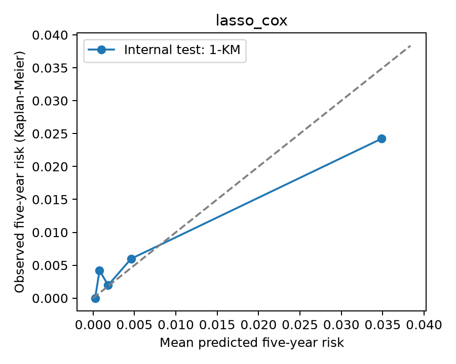
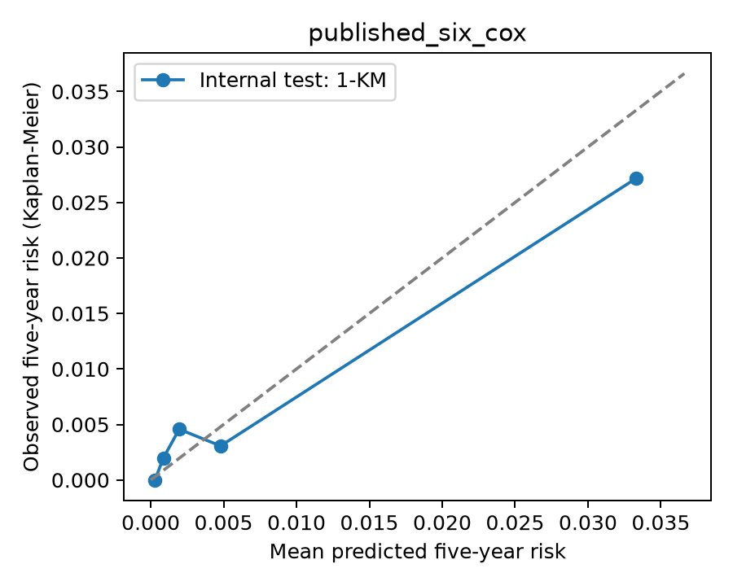

# Báo cáo đối chiếu Cai 2021 — thực hành NAGALA

Ngày 05/11/2026. **Baseline same-data method reconstruction đã chạy thành công trên Kaggle CPU**, đã tải và đọc output/log. Đây không phải khớp chính xác mô hình tác giả và không phải validation ngoài NAGALA. Dữ liệu từng người không được đưa lên GitHub.

## Bản chạy đã xác minh

- [Notebook thành công](https://www.kaggle.com/code/phaninmnhthink16/cai2021-nagala-reconstruction-20261105-r3), version number **1**, kernel ID **142910325**, tài khoản `phaninmnhthink16`.
- [Dataset](https://www.kaggle.com/datasets/phaninmnhthink16/cai2021-nagala-original-20261105), version 1; public theo cập nhật của anh trong chat. Workbook giữ nguyên byte/checksum từ ZIP đã cung cấp.
- Source commit `71b4045941d6b99e012effc16d58b460c0253863`; source SHA256 `2e94deaf54a56fc3347dfe9973226540f1059ef0fe1dc1273e2001d2deb28f89`.
- Kaggle Python **3.13.18**; thư viện có phiên bản trong [manifest](../qc/run_20261105_attempt3_v1/study/run_manifest.json) và [environment lock](../qc/run_20261105_attempt3_v1/environment-lock.txt).
- [Read-back verification](../qc/run_20261105_attempt3_v1/readback_verification.json): commit, workbook, notebook/version, source/config freeze và hai model hashes đều khớp. [Study log](../qc/run_20261105_attempt3_v1/study.log) kết thúc `complete`. Cả 9 kiểm thử mô phỏng qua trong Kaggle.
- Pipeline/model/config được lưu trước lần đánh giá final test; hai mô hình đều được chỉ định trước. Không chọn mô hình hay cập nhật mô hình theo test.

## Tác giả và bản tái dựng chính

Nguồn tác giả: [Cai et al. 2021](https://pmc.ncbi.nlm.nih.gov/articles/PMC8123981/), Table 1 (mẫu/biến cố), Table 2 và Figure 2 (LASSO), Table 3 (C-index), Model Performance (AUC/calibration), Statistical Analyses (quy trình). Các trường UNKNOWN không được điền bằng suy đoán. DOI Cai và bài gốc Okamura đã được kiểm tra qua [reference audit](../qc/reference_audit.json).

| Mục | Tác giả | Kết quả của mình | Khác biệt thiết kế/cách tính | Giải thích |
|---|---|---|---|---|
| Toàn cohort / biến cố toàn follow-up | 12.940 / 201 | 12.940 / 201 | BMI <25 trên cùng workbook | Khớp số người, biến cố và median follow-up; không xác minh lại được mọi loại trừ upstream |
| Development / biến cố | 9.651 / 154 | 9.705 / 151 | 75/25 stratified split, seed 20261105; seed gốc UNKNOWN | Không tìm seed để ép khớp |
| Internal validation/test / biến cố | 3.289 / 47 | 3.235 / 50 | Cùng NAGALA, random split khác | Không phải external validation |
| Biến cố trong 5 năm (toàn cohort / test) | UNKNOWN / UNKNOWN | 76 / 16 | Mốc 1826,25 ngày; 201/50 là toàn follow-up | Không coi người censor sớm là âm tính |
| Predictors cuối | Tuổi, fatty liver, GGT, TG, HbA1c, FPG | Tuổi, vòng eo, TG, HbA1c, FPG, fatty liver, heavy alcohol contrast | 18 concepts / 21 encoded columns; Cox LASSO relative grid, one-SE | Không ép chọn sáu biến; không chọn phương án bằng test |
| Validation C-index (95% CI) | 0,837 (0,760–0,914) | 0.879 (0.817–0.934) | Harrell C toàn follow-up; bootstrap test có điều kiện mô hình cố định | Có thể khác do split, selection và bootstrap; chưa lượng hóa từng nguyên nhân |
| Validation AUC 5 năm (95% CI) | 0,829 (0,753–0,905) | 0.842 (0.729–0.942) | Cumulative/dynamic IPCW AUC, censoring distribution từ development | Không phải bằng chứng thắng mô hình bài báo; mẫu test khác và CI rộng |
| Brier 5 năm (95% CI) | UNKNOWN | 0.00688 (0.00421–0.01022) | IPCW; không gán censor sớm thành non-event | Brier nhỏ chưa đủ chứng minh chất lượng khi sự kiện hiếm |
| Calibration | Tác giả báo cáo phù hợp; Hosmer–Lemeshow và đường calibration | Intercept=-0.191; slope=0.763 | IPCW logistic diagnostics; nhóm nguy cơ đối chiếu 1−KM(5y) | Mốc lý tưởng 0 / 1; chưa hoàn hảo, không tái hiệu chỉnh bằng test |
| PH assumption | UNKNOWN | HbA1c: p=0,000559 trong Cox sau LASSO | Schoenfeld rank test trên development | Có dấu hiệu tác động thay đổi theo thời gian; cần ghi hạn chế |
| DCA | Thực hiện trên toàn cohort theo bài | Chưa thực hiện | Chỉ làm khi xử lý censoring phù hợp | Không có khẳng định clinical utility từ thực hành này |

Bảng cũng có dưới dạng [CSV](COMPARISON_TABLE.csv). Chỉ số không thể dùng để kết luận mô hình mình vượt bài gốc: split và số biến cố test khác, original code/seed chưa được xác minh, một số cách tính được tái dựng bằng giả định. Khoảng tin cậy chồng lấp cũng không chứng minh hai phương pháp tương đương.

## Cả hai mô hình đã chỉ định trước

Mô hình sáu biến được fit lại trên development, không chép hệ số LASSO của Table 2. Nó là đối chiếu kỹ thuật; không thay thế mô hình sau LASSO chỉ vì test tốt hơn. Danh sách sáu biến vốn được công bố từ chính NAGALA, nên đối chiếu này không phải bằng chứng chọn biến độc lập với lịch sử sử dụng dataset của bài gốc.

| Mô hình | Harrell C (95% CI) | IPCW AUC 5 năm (95% CI) | IPCW Brier 5 năm (95% CI) | Calibration intercept / slope |
|---|---|---|---|---|
| Cox sau LASSO — tái dựng chính | 0.879 (0.817–0.934) | 0.842 (0.729–0.942) | 0.00688 (0.00421–0.01022) | -0.191 / 0.763 |
| Cox sáu biến công bố — đối chiếu | 0.888 (0.828–0.939) | 0.857 (0.756–0.949) | 0.00640 (0.00373–0.00950) | -0.102 / 0.880 |

Mỗi CI dùng **1000/1000** bootstrap test hợp lệ, giữ mô hình và censoring distribution development cố định. Không phải CI bao trùm bất định của toàn bộ selection/training pipeline. Internal test có 50 biến cố toàn follow-up nhưng chỉ **16 trước 5 năm**; 1.473 người censor trước mốc và 1.746 người còn at risk tại mốc. Vì ít biến cố, AUC và calibration tại 5 năm có bất định lớn.

LASSO chọn 7 cột nêu trên, với relative penalty **0.209910**, alpha full-development **0.0043892666**. Có đủ 60 điểm path ở mọi fold/full development. Không diễn giải alpha này là bản sao lambda gốc hoặc dùng nó để suy ra tác giả thực thi cùng cấu hình.

## Calibration và proportional hazards

Intercept âm khi cố định slope=1 cho thấy xu hướng dự báo cao hơn dữ liệu test theo diagnostic này. Slope 0,763 của mô hình sau LASSO gợi ý xác suất còn quá phân tán, song chưa có CI cho slope và test có rất ít biến cố; không kết luận quá mức về cơ chế sai lệch. Nhóm nguy cơ cao nhất dự báo trung bình 3,49%, trong khi 1−KM(5y) khoảng 2,42%; nhóm này có 11 biến cố trong 5 năm. Đường calibration chỉ mô tả năm nhóm, không chứng minh calibration tốt toàn miền nguy cơ.

Schoenfeld rank tests trên development phát hiện dấu hiệu không thỏa proportional hazards của HbA1c ở cả hai mô hình: p=0,000559 (sau LASSO), p=0,000621 (sáu biến). Các p-value là diagnostic theo từng biến, chưa hiệu chỉnh nhiều phép thử; vấn đề được giữ trong báo cáo, không thay mô hình sau khi xem test. Vì vậy không chuyển baseline này thành công cụ sử dụng lâm sàng hoặc khẳng định nguy cơ tuyệt đối đã được validation đầy đủ.

## Tái dựng được gì, còn thiếu gì?

**Đã làm:** audit workbook/source checksum; cohort đúng 12.940/201; dictionary/registry; split cố định; preprocessing trong training fold; ten-fold Cox LASSO/one-SE; refit Cox; kiểm tra PH; lưu predictive bundle gồm beta, centering, median và toàn bộ baseline cumulative hazard để khôi phục survival/probability; đánh giá censoring-aware; bootstrap CI; manifest/log/figures và run Kaggle có source Git cố định.

**Giả định tái dựng:** lấy 18 concepts của Table 1; encoding 21 cột; Cox LASSO dựa vào Figure 2 nhưng family thực thi gốc vẫn chưa xác nhận; CV held-out partial likelihood theo relative grid thay vì khẳng định đúng cv.glmnet grouped deviance; split/seed mới; 5 năm=1826,25 ngày; Efron ties/Breslow baseline. Tất cả nằm trong [đặc tả](RECONSTRUCTION_SPEC.md).

**Cải thiện được tách riêng:** nhận diện 8 HDL thiếu ẩn bằng hai cột đơn vị và impute trong training fold; dùng IPCW AUC/Brier/calibration và 1−KM để không ép người censor sớm thành non-event; PH diagnostic; đóng gói đầy đủ phần dự báo và provenance. Không gọi các phần này là quy trình gốc đã xác minh.

**Chưa tái dựng:** nguyên trạng split/code/environment tác giả; chính xác LASSO family/loss/encoding; xác suất của nomogram gốc do chưa có đầy đủ beta Cox/baseline survival gốc; toàn bộ chẩn đoán và loại trừ upstream từ visit-level data; DCA censoring-aware; external validation; full-pipeline uncertainty. Không viết “không có code” khi mới chưa xác minh được code.

## Lịch sử lỗi và tính độc lập của test

1. Attempt 1: source Git tải đúng, nhưng venv/ensurepip không có trong runtime Kaggle. Dừng trước dữ liệu/model; [log](../qc/failed_runs/kaggle_attempt1_v1.log) được giữ.
2. Attempt 2: môi trường và 9 tests qua; fixed absolute LASSO grid/cold tail completion gây warnings/lỗi số học trong development. [Manifest](../qc/failed_runs/attempt2_v1/run_manifest.json) ghi `final_test_used=false`; chưa có pipeline freeze hay test metrics.
3. Amendment revision 2 dùng fold-relative warm-start paths, hội tụ được kiểm tra; giữ cohort/outcome/horizon/split. Development readiness và independent review hoàn tất trước test. Attempt 3 thành công; **đây là lần duy nhất đánh giá final test** cho cả hai mô hình đã chỉ định trước.

Không sửa mô hình theo kết quả test. Nếu nghiên cứu tiếp time-varying effects/splines hoặc thay selection, cần quy trình development/validation mới và giữ test đã xem này ở trạng thái “đã sử dụng”, không gọi nó là test mới độc lập.

## Chạy lại và tiếp tục

Đọc [README](../README.md), [giải thích phương pháp](EXPLAIN_METHOD_VI.md), [cohort report](COHORT_REPORT_VI.md), [PROGRESS](../PROGRESS.json). Source GitHub là source of truth; notebook tải đúng commit và kiểm tra từng file hash. Dùng output directory/run ID mới để bảo toàn lịch sử. Tái chạy nguyên cấu hình để kiểm tra tính tái lập không cho phép chỉnh lựa chọn mô hình theo test.
